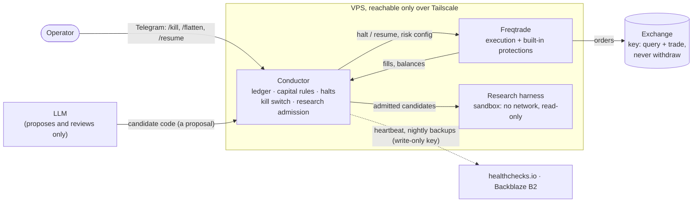

# Guarded Trader

A safety-first framework for running a small crypto trading system in which an LLM may
**research** strategies but can never **trade**. A deterministic engine
([Freqtrade](https://www.freqtrade.io/)) places every order, inside hard risk limits enforced by
a second, independent service. Everything is written down first: requirements, risks,
decisions, runbooks, and the results, including the bad ones.

> **Not financial advice.** This is a research and engineering project. It has **no proven
> trading edge**, and its own published results show strategies losing money (below). Don't
> trade real money because of anything in this repository. Crypto trading can lose all of
> the money you put in.

## What it is

- **An execution and safety platform**: Freqtrade does the trading; **Conductor** (a Python
  service) holds the ledger, enforces capital rules, and owns halts, the kill switch and alerts.
- **A research harness**: sandboxed (no network, read-only) walk-forward backtests, a
  random-entry null, Deflated Sharpe, and an append-only registry that counts every trial.
- **A public record**: 22+ architecture decision records, a risk register, runbooks written to
  be followed half-asleep at 2 am, and drill results from the real server.
- Designed around a **one-time $100** principal, never topped up, run by one Canadian
  operator (so CAD reporting and CRA questions show up in the docs).

## What it is not

- **Not a money-maker.** No strategy has passed the project's own first gate at real fees.
- **Not an LLM trading bot.** The LLM never places, changes or cancels an order, and never
  sees an exchange key ([ADR-0003](docs/05-adr/0003-llm-never-orders.md)).
- Not high-frequency, leveraged or margin trading (4h/1d bars only,
  [ADR-0005](docs/05-adr/0005-low-frequency-only.md)).
- Not a signal service, a product, or managed money.

## Architecture



The invariant: **no path leads from the LLM to the exchange.** Every LLM output ends at
Conductor as a proposal. More: [`docs/04-architecture/`](docs/04-architecture/).

## Safety model

- **Hard rules** ([`CLAUDE.md`](CLAUDE.md) §0) for people and agents alike: the LLM never
  orders; no withdrawal-capable key anywhere; no secrets in the repo; capital rules R1–R6
  ([`docs/02-requirements.md`](docs/02-requirements.md)) are constraints, not settings.
- **Two independent risk layers**: Freqtrade's protections, plus Conductor's own checks of
  daily loss, drawdown and loss streaks. Every halt needs a human to clear it.
- **Fail-closed boot**: Freqtrade always starts paused; Conductor starts it only when no halt
  is active ([ADR-0018](docs/05-adr/0018-fail-closed-freqtrade-boot.md)).
- **Account isolation (R5)**: the system refuses to start rather than trade coins it didn't buy.
- **Profit fencing**: profit above a daily cap is fenced in the ledger. Moving money is always
  a manual human action on the exchange's own site.
- **Verified keys**: key scopes are tested behaviourally from the server. A venue whose key
  can't be proven unable to withdraw is rejected
  ([ADR-0022](docs/05-adr/0022-ndax-rejected-for-live.md)).
- **Promotion path**: backtest → walk-forward → 3-week paper → 25 % → 100 %, with no skipping
  ([`docs/08-paper-exit-criteria.md`](docs/08-paper-exit-criteria.md)).
- **Drilled**: kill switch, nuclear flatten, restart under a halt, heartbeat silence, backup
  restore and a full server rebuild all passed on the real VPS
  ([`docs/drills/`](docs/drills/)).

## Results so far

All registered candidates, 2022-01-01 → 2026-10-01, $100 start, at the fee a small Kraken
account actually pays (0.80 % taker + 0.10 % slippage per side)
([`docs/research/05-first-candidates.md`](docs/research/05-first-candidates.md)):

| Strategy | Net profit | Max drawdown | Beats random-entry null? | Gate 1 |
|---|---|---|---|---|
| Baseline4h (EMA cross, ATR stop) | −$65.47 | 83.7 % | no | fail |
| C05 (EMA flip, 4h) | −$61.48 | 83.2 % | no | fail |
| C01 (weekly time-series momentum) | −$88.63 | 91.8 % | no | fail |
| C04 (C01 + volatility sizing) | −$29.84 | 38.0 % | no | fail |
| *BTC buy-and-hold, no fees* | *+$75.00* | *67.0 %* | — | — |

At a cheaper venue's 0.20 % fee, C05 beat its null's Sharpe 95th percentile but still failed
Gate 1, and lost money again at twice that fee
([`docs/research/06-ndax-feasibility.md`](docs/research/06-ndax-feasibility.md)). No real
money has been traded. **Live trading is paused** (status and revisit triggers:
[`docs/07-roadmap.md`](docs/07-roadmap.md)).

The gates kept every no-edge strategy away from real money, and none was lowered to let one
through. That is the result we wanted to be able to report.

## Quick start (dry-run, local)

Needs Docker with Compose v2 and GNU Make. No exchange key and no money; Freqtrade
paper-trades against public market data.

```bash
git clone https://github.com/aplicy/guarded-trader.git
cd guarded-trader
cp .env.example .env
# Fill in only these three (any local values; they guard the loopback-only REST API):
#   FREQTRADE__API_SERVER__USERNAME, FREQTRADE__API_SERVER__PASSWORD,
#   FREQTRADE__API_SERVER__JWT_SECRET_KEY
# Leave TRADING_MODE=dry_run and every exchange key empty.
make up                          # Freqtrade + Conductor, bound to 127.0.0.1 only
make logs                        # expect "Dry run is enabled"
```

The Conductor dashboard is at <http://127.0.0.1:8000>; Freqtrade's API at
<http://127.0.0.1:8080>. Stop with `make down`. Tests and lint: `make conductor-test`,
`make conductor-lint`, `make research-test`, `make research-lint`.

Telegram, healthchecks.io, B2 backups and the VPS are optional in dry-run. Setting them up:
[`docs/06-runbooks/provision-vps.md`](docs/06-runbooks/provision-vps.md). Going live is
deliberately hard and gated: [`docs/06-runbooks/go-live-pilot.md`](docs/06-runbooks/go-live-pilot.md).

## Repository map

| | |
|---|---|
| Vision, non-goals, current standing | [`docs/00-vision.md`](docs/00-vision.md) |
| Research review behind the design | [`docs/research/01-research-review.md`](docs/research/01-research-review.md) |
| Requirements (R1–R6, NFRs) | [`docs/02-requirements.md`](docs/02-requirements.md) |
| Risk register | [`docs/03-risk-register.md`](docs/03-risk-register.md) |
| Architecture | [`docs/04-architecture/`](docs/04-architecture/) |
| Decision records | [`docs/05-adr/`](docs/05-adr/) |
| Runbooks | [`docs/06-runbooks/`](docs/06-runbooks/) |
| Roadmap and status | [`docs/07-roadmap.md`](docs/07-roadmap.md) |
| Gates (backtest → paper → live) | [`docs/08-paper-exit-criteria.md`](docs/08-paper-exit-criteria.md) |
| Rules for AI-assisted work | [`CLAUDE.md`](CLAUDE.md) |

Code: `services/conductor/` (Conductor), `services/research/` (harness and candidates),
`services/freqtrade/` (engine config and the reference strategy), `infra/` (Compose,
Terraform), `scripts/` (operational checks).

## How it was built

Most code and docs were written with AI coding assistants (Claude Code), under the rules in
[`CLAUDE.md`](CLAUDE.md), and reviewed and run by a human operator. Assistants work on this
repository; they never operate the trading system.

## Contributing, security, licence

- [`CONTRIBUTING.md`](CONTRIBUTING.md): the safety rules are review criteria, and strategy
  ideas must be pre-registered.
- [`SECURITY.md`](SECURITY.md): report vulnerabilities privately (security@aplicy.com).
- [`CODE_OF_CONDUCT.md`](CODE_OF_CONDUCT.md).
- Apache License 2.0, © 2026 Aplicy Inc. See [`LICENSE`](LICENSE) and [`NOTICE`](NOTICE)
  (third-party licences, including how this relates to Freqtrade's GPL-3.0).
