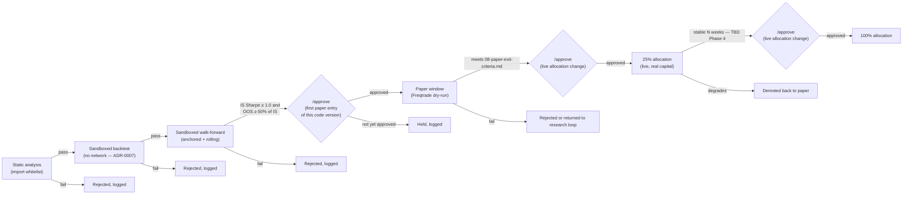

# Architecture — Conductor

Conductor is our own service (Python, FastAPI — decision D2 in the research
review) that owns everything Freqtrade does not: the research loop, the
ledger, promotion gates, the daily profit fence, the kill switch, and the
Telegram control surface. Freqtrade never talks to Claude, Telegram, or the
sweep destination directly — and neither does Conductor: profit fencing is
a ledger-only accounting operation, and the physical move of fenced funds
to the sweep destination is always a manual, human action taken outside
this system entirely (R3).

## Responsibilities

| Component | Responsibility |
|---|---|
| Nightly research-loop worker | Once per night, assembles market/strategy-performance context, prompts Claude for candidate strategies/parameter changes/post-mortems, logs the full prompt+response with a content hash. |
| Candidate code admission | Static analysis (import whitelist; `os`, `subprocess`, `socket`, `requests`, and file writes forbidden) on every candidate before it is executed at all; candidates that pass run backtest and walk-forward inside a throwaway, network-disabled sandbox container — never the live Freqtrade environment. See [`ADR-0007`](../05-adr/0007-candidate-code-admission.md). |
| Promotion-gate engine | Evaluates each admitted candidate against the numeric gates in `08-paper-exit-criteria.md`, routes required human `/approve` steps, and — once approved — advances a strategy through paper → 25% → 100% allocation. Enforces NFR5 (overfitting defence) and the ≤6-parameter cap. Never skips a stage or an approval. |
| Risk-limit checker | Independently re-derives daily loss, drawdown from peak, and consecutive-loss state from the ledger (not from Freqtrade's own view) and can halt Freqtrade via its REST API even if Freqtrade's own protections have not fired — the second layer required by R4/AC4.4. |
| Profit-fence job | Once per UTC day, computes working profit and, if it exceeds `daily_profit_cap`, fences the excess in the ledger — a ledger-only operation, no exchange call (R3). Alerts the operator when cumulative fenced-but-unmoved profit crosses the manual-move threshold or a month has passed, but never initiates a transfer itself — the physical move off-exchange is always a manual, human action. |
| Telegram bot handler | Authenticates commands against an allow-list of chat IDs; exposes kill switch, flatten, status, re-enable, and `/approve`; posts alerts (halts, missed fencing runs, manual-move due, heartbeat silence). |
| Ledger | Postgres (TBD Phase 3) — append-mostly record of: principal, every fill (ingested by Conductor by polling Freqtrade's REST API — **Freqtrade never writes to the ledger directly**), every halt/resume event with operator identity, every fencing event and manual transfer, every promotion-gate decision including `/approve` actions, every candidate-code-admission result (static-analysis verdict, sandbox metrics), every LLM prompt/response hash. |

## Nightly research-loop flow

See [`data-flow.md`](data-flow.md) for the full sequence diagram. In
summary: gather context → prompt Claude → log response → candidate code
admission (static analysis; if it passes, backtest + walk-forward run
inside a throwaway, network-disabled sandbox — never the live Freqtrade
environment, [`ADR-0007`](../05-adr/0007-candidate-code-admission.md)) →
if the numeric gates in `08-paper-exit-criteria.md` pass, the candidate
is queued for a human `/approve` before its first entry into the paper
stage → only on approval does the promotion-gate engine update which
strategy version Freqtrade is running, and only in dry-run at that point.

## Promotion pipeline

Every arrow that advances a stage is either a Conductor decision based on
numeric criteria in
[`08-paper-exit-criteria.md`](../08-paper-exit-criteria.md) — never a
judgement call made inside an LLM prompt — or an explicit, logged human
`/approve` at the two points that matter most: a new code version's first
entry into paper trading, and every live allocation change. See
[`ADR-0007`](../05-adr/0007-candidate-code-admission.md).

## Kill switch vs. nuclear protocol

Two distinct, deliberately different-severity controls, both owned by
Conductor:

- **Kill switch** — blocks *new* order entry only. Existing positions are
  left to their own stop-losses/take-profits. Reversible by an
  authenticated re-enable command. See
  [`06-runbooks/kill-switch.md`](../06-runbooks/kill-switch.md).
- **Nuclear protocol** — cancels open orders and flattens positions where
  safely possible, in addition to halting new entry. Reserved for data
  loss, exchange anomaly, or any state where the system's view of reality
  may be wrong. See
  [`06-runbooks/nuclear-protocol.md`](../06-runbooks/nuclear-protocol.md).

Both persist their state in the ledger (AC4.5) and both require an
explicit, logged human action to clear (AC4.6).

## Telegram command surface (draft — finalized Phase 3)

| Command | Effect | Auth |
|---|---|---|
| `/status` | Current halt state, open positions, today's P&L, promotion-pipeline status | Allow-listed chat ID |
| `/kill` | Engage kill switch (block new entries) | Allow-listed chat ID |
| `/flatten` | Engage nuclear protocol | Allow-listed chat ID |
| `/resume` | Clear a halt — requires the specific halt type as an argument, logged with operator identity | Allow-listed chat ID |
| `/approve <strategy-id>` | Human sign-off gate. **Required** for (a) a new code version's first entry into the paper stage, and (b) every live allocation change (paper→25%, 25%→100%) — see [`ADR-0007`](../05-adr/0007-candidate-code-admission.md). Numeric gates otherwise pass automatically once met; this is the one place a human explicitly reviews before real capital exposure changes. | Allow-listed chat ID |

## Heartbeat

Heartbeat monitoring is **push, not pull**: Conductor pushes an outbound
ping to a dead-man's-switch monitoring service — [healthchecks.io](
https://healthchecks.io/) free tier is the current default choice — on a
fixed interval (TBD Phase 3, NFR4). The monitoring service, not the
trading host, is responsible for noticing silence: if a ping doesn't
arrive within its configured grace period, the service itself fires the
alert.

This is deliberate. A pull-based watchdog would need to reach *into* the
host to check on it, which means an inbound endpoint on a host that
otherwise has none (`security.md`'s no-inbound-ports posture). Push
avoids that entirely — the host only ever makes outbound calls, same as
its Kraken and Anthropic API traffic — and it naturally covers the case
that matters most: if the host is down, asleep, or network-partitioned,
the ping simply stops arriving and the external service notices without
needing anything on the (unreachable) host to run.

## TBD

- Ledger DB engine and migration tooling — TBD (Phase 3).
- Exact heartbeat ping interval and healthchecks.io grace-period
  configuration — TBD (Phase 3).
- Sandbox runtime implementation and static-analysis tooling for
  candidate code admission — TBD (Phase 2/3), see
  [`ADR-0007`](../05-adr/0007-candidate-code-admission.md).
