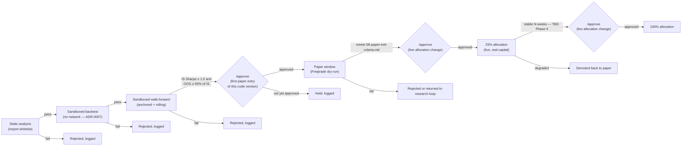

# Architecture — Conductor

Conductor is our own service (Python, FastAPI — decision D2 in the research
review) that owns everything Freqtrade does not: the research loop, the
ledger, promotion gates, the daily profit fence, the kill switch, and the
Telegram control surface. Freqtrade never talks to Claude, Telegram, or the
sweep destination directly — and neither does Conductor: profit fencing is
a ledger-only accounting operation, and the physical move of fenced funds
to the sweep destination is always a manual, human action taken outside
this system entirely (R3).

## Responsibilities

| Component | Responsibility |
|---|---|
| Nightly research-loop worker | Once per night, assembles market/strategy-performance context, prompts Claude for candidate strategies/parameter changes/post-mortems, logs the full prompt+response with a content hash. |
| Candidate code admission | Static analysis (import whitelist; `os`, `subprocess`, `socket`, `requests`, and file writes forbidden) on every candidate before it is executed at all; candidates that pass run backtest and walk-forward inside a throwaway, network-disabled sandbox container — never the live Freqtrade environment. See [`ADR-0007`](../05-adr/0007-candidate-code-admission.md). |
| Promotion-gate engine | Evaluates each admitted candidate against the numeric gates in `08-paper-exit-criteria.md`, routes required human `/approve` steps, and — once approved — advances a strategy through paper → 25% → 100% allocation. Enforces NFR5 (overfitting defence) and the ≤6-parameter cap. Never skips a stage or an approval. |
| Risk-limit checker | Independently re-derives daily loss, drawdown from peak, and consecutive-loss state from the ledger (not from Freqtrade's own view) and can halt Freqtrade via its REST API even if Freqtrade's own protections have not fired — the second layer required by R4/AC4.4. |
| Profit-fence job | Once per UTC day, computes working profit and, if it exceeds `daily_profit_cap`, fences the excess in the ledger — a ledger-only operation, no exchange call (R3). Alerts the operator when cumulative fenced-but-unmoved profit crosses the manual-move threshold or a month has passed, but never initiates a transfer itself — the physical move off-exchange is always a manual, human action. |
| Telegram bot handler | Authenticates commands against an allow-list of chat IDs; exposes kill switch, flatten, status, re-enable, and `/approve`; posts alerts (halts, missed fencing runs, manual-move due, backup failures). Heartbeat silence is announced by healthchecks.io, not by Conductor, since a dead Conductor cannot send anything. |
| Heartbeat | Every 5 minutes pings healthchecks.io **only while Conductor is healthy** (DB ok, scheduler running, last risk cycle succeeded within 3 min); pings `/fail` with a reason otherwise; silence means dead (see "Heartbeat" below). |
| Backup job | Nightly 03:15 UTC: consistent SQLite online backups of the ledger and Freqtrade's dry-run DB, integrity-checked, gzipped, uploaded to Backblaze B2 with a write-only key; audit-logged, Telegram alert on failure ([`ADR-0016`](../05-adr/0016-backups-write-only-key-no-client-side-encryption.md)). |
| Dashboard | Read-only web UI (FastAPI + Jinja + HTMX, Chart.js vendored): overview, positions and trades, halts and audit log; strategies and research are placeholders until 3B. Tailnet-only ([`ADR-0017`](../05-adr/0017-read-only-dashboard-over-tailscale.md)). |
| Ledger | SQLite in WAL mode, single file written only by Conductor ([`ADR-0009`](../05-adr/0009-sqlite-ledger.md)), migrated with Alembic — append-mostly record of: principal, every fill (ingested by Conductor by polling Freqtrade's REST API — **Freqtrade never writes to the ledger directly**), every halt/resume event with operator identity, every fencing event and manual transfer, every promotion-gate decision including `/approve` actions, every candidate-code-admission result (static-analysis verdict, sandbox metrics), every LLM prompt/response hash. |

## Nightly research-loop flow

See [`data-flow.md`](data-flow.md) for the full sequence diagram. In
summary: gather context → prompt Claude → log response → candidate code
admission (static analysis; if it passes, backtest + walk-forward run
inside a throwaway, network-disabled sandbox — never the live Freqtrade
environment, [`ADR-0007`](../05-adr/0007-candidate-code-admission.md)) →
if the numeric gates in `08-paper-exit-criteria.md` pass, the candidate
is queued for a human `/approve` before its first entry into the paper
stage → only on approval does the promotion-gate engine update which
strategy version Freqtrade is running, and only in dry-run at that point.

## Promotion pipeline

Every arrow that advances a stage is either a Conductor decision based on
numeric criteria in
[`08-paper-exit-criteria.md`](../08-paper-exit-criteria.md) — never a
judgement call made inside an LLM prompt — or an explicit, logged human
`/approve` at the two points that matter most: a new code version's first
entry into paper trading, and every live allocation change. See
[`ADR-0007`](../05-adr/0007-candidate-code-admission.md).

## Kill switch vs. nuclear protocol

Two distinct, deliberately different-severity controls, both owned by
Conductor:

- **Kill switch** — blocks *new* order entry only. Existing positions are
  left to their own stop-losses/take-profits. Reversible by an
  authenticated re-enable command. See
  [`06-runbooks/kill-switch.md`](../06-runbooks/kill-switch.md).
- **Nuclear protocol** — cancels open orders and flattens positions where
  safely possible, in addition to halting new entry. Reserved for data
  loss, exchange anomaly, or any state where the system's view of reality
  may be wrong. See
  [`06-runbooks/nuclear-protocol.md`](../06-runbooks/nuclear-protocol.md).

Both persist their state in the ledger (AC4.5) and both require an
explicit, logged human action to clear (AC4.6).

## Telegram command surface

Implemented in 3A-4 ([`ADR-0015`](../05-adr/0015-conductor-owns-telegram.md)).
Outbound long polling only; only allow-listed chat IDs are answered (anyone else
is ignored silently and logged). Writes ask first: the bot replies with a random
4-character code, and the action runs only if the **same chat** answers
`yes <code>` within 60 s (a wrong code, a late answer, or another chat does
nothing). The chat ID is recorded as the operator identity (`telegram:<id>`).
No command can open or size a trade.

| Command | Effect | Confirmation |
|---|---|---|
| `/status` | Mode, active halts, Freqtrade state per instance, open positions, today's P&L (UTC) | no |
| `/capital` | Principal, realized profit, fenced, working profit, max deployed capital | no |
| `/halts` | Active halts with reason, scope, time and who raised them | no |
| `/trades` | Last 10 closed trades | no |
| `/help` | Command list | no |
| `/kill` | Kill switch: block new entries (`kill_switch` halt) | **yes** |
| `/flatten` | Nuclear: pause, cancel orders, market-exit all, confirm flat, stop | **yes** |
| `/resume <halt_id>` | Clear that halt and resume if no other halt covers the instance | **yes** |
| `/approve <strategy-id>` | Human sign-off gate for promotion (ADR-0007) — **Phase 3B**, not implemented yet | n/a |

### Alerts (Conductor to the allow-listed chats)

Halt created (R4/R2/R7, kill, nuclear) and cleared; kill/nuclear step results
(nuclear always, kill only on failure); trade opened/closed (from ingest, only
for events in the last 6 h, once per ledger transition, so restarts and the
first import never replay history); fence events, missed fence days and
"manual move due" (once per UTC day); Freqtrade unreachable for more than 10
minutes (and recovery); Conductor startup. Identical alerts are deduplicated
for 5 minutes and delivery is capped at 10 per minute (overflow is summarised).
Alerts are best effort and **never** on the risk path: a Telegram outage cannot
block, delay or fail a risk check, halt or enforcement.

## Heartbeat

Implemented in 3A-5. Heartbeat monitoring is **push, not pull**: Conductor
pushes an outbound ping to a dead-man's-switch service
([healthchecks.io](https://healthchecks.io/), `HEALTHCHECK_PING_URL`) and the
service, not the trading host, is responsible for noticing silence.

| Situation | What Conductor does | What healthchecks.io does |
|---|---|---|
| Healthy | pings the check URL every 5 min | nothing (check stays up) |
| Alive but unhealthy | pings `<url>/fail` with a short reason (it shows in the alert) | alerts immediately |
| Dead / VPS down / network partitioned | nothing (it cannot) | alerts after the grace period |

**Healthy** means all of: the database answers and is in WAL mode, the
scheduler is running, and the last risk cycle *completed without raising*
within the last 3 minutes. A risk cycle that ran but found Freqtrade
unreachable still counts as completed: that condition has its own Telegram
alert after 10 minutes, and the heartbeat answers "is Conductor itself
working". The decision is a pure function (`application/heartbeat.py`).

Configure the check with **Period 5 min, Grace 10 min** so an outage alerts
after about 15 minutes of silence (NFR4). The ping URL contains the check's
UUID, so it is a secret: it is a `SecretStr`, never logged, and never in an
error message. Delivery is outbound HTTPS only (one retry); a failed ping is
logged, shown on the dashboard, and never affects trading. With no URL set
the heartbeat logs only and makes no network call.

## Backups

Implemented in 3A-5; decision and trade-offs in
[`ADR-0016`](../05-adr/0016-backups-write-only-key-no-client-side-encryption.md).
At 03:15 UTC each source database (Conductor's ledger; Freqtrade's dry-run DB
through a read-only mount of its `user_data` directory) is copied with SQLite's
online backup API, `PRAGMA integrity_check`ed on the copy, gzipped, and uploaded
to B2's S3 API under a dated, unique key. The credential is write-only, so the
code only ever calls PutObject; nothing is read back, listed or deleted by
Conductor, and B2's lifecycle rule expires files after 30 days. Each outcome is
an audit-log row (`backup_completed` / `backup_failed`); a failure sends one
Telegram alert. `python -m conductor.cli backup-now` runs it on demand. Proof
that a backup is restorable comes from
[`restore-backup.md`](../06-runbooks/restore-backup.md).

## Dashboard

Implemented in 3A-5; decision in
[`ADR-0017`](../05-adr/0017-read-only-dashboard-over-tailscale.md). Strictly
read-only: GET routes only, no forms, no write actions (writes stay on
Telegram, behind confirmation). Pages: **Overview** (principal, working,
fenced, max deployed, halt state, equity curve, heartbeat and backup status),
**Positions & trades**, **Halts & audit log**; **Strategies** and **Research**
are placeholders until Phase 3B. Static assets (htmx, Chart.js) are vendored
and served by Conductor itself; a strict CSP forbids anything else. The port is
published on host loopback only and exposed to the tailnet with
`tailscale serve` ([`provision-vps.md`](../06-runbooks/provision-vps.md) steps
24-29). There is no login: the tailnet is the authentication.

## TBD

- ~~Exact heartbeat ping interval and healthchecks.io grace-period
  configuration~~ — resolved 3A-5: 5 min ping, 10 min grace.
- Backup restore-drill cadence after the first one — TBD (Phase 3, 3A-6).
- Sandbox runtime implementation and static-analysis tooling for
  candidate code admission — TBD (Phase 3), re-tagged from "Phase 2/3"
  during Phase 2 closure (Conductor doesn't exist until Phase 3), see
  [`ADR-0007`](../05-adr/0007-candidate-code-admission.md).
