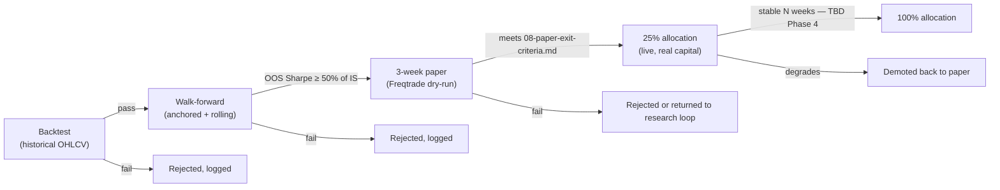

# Architecture — Conductor

Conductor is our own service (Python, FastAPI — decision D2 in the research
review) that owns everything Freqtrade does not: the research loop, the
ledger, promotion gates, the daily profit fence, the kill switch, and the
Telegram control surface. Freqtrade never talks to Claude, Telegram, or the
sweep destination directly — and neither does Conductor: profit fencing is
a ledger-only accounting operation, and the physical move of fenced funds
to the sweep destination is always a manual, human action taken outside
this system entirely (R3).

## Responsibilities

| Component | Responsibility |
|---|---|
| Nightly research-loop worker | Once per night, assembles market/strategy-performance context, prompts Claude for candidate strategies/parameter changes/post-mortems, logs the full prompt+response with a content hash. |
| Promotion-gate engine | Runs each candidate through backtest → walk-forward → (if it passes) marks it eligible for the 3-week paper stage → 25% → 100% allocation. Enforces NFR5 (overfitting defence) and the ≤6-parameter cap. Never skips a stage. |
| Risk-limit checker | Independently re-derives daily loss, drawdown from peak, and consecutive-loss state from the ledger (not from Freqtrade's own view) and can halt Freqtrade via its REST API even if Freqtrade's own protections have not fired — the second layer required by R4/AC4.4. |
| Profit-fence job | Once per UTC day, computes working profit and, if it exceeds `daily_profit_cap`, fences the excess in the ledger — a ledger-only operation, no exchange call (R3). Alerts the operator when cumulative fenced-but-unmoved profit crosses the manual-move threshold or a month has passed, but never initiates a transfer itself — the physical move off-exchange is always a manual, human action. |
| Telegram bot handler | Authenticates commands against an allow-list of chat IDs; exposes kill switch, flatten, status, and re-enable; posts alerts (halts, missed fencing runs, manual-move due, heartbeat silence). |
| Ledger | Postgres (TBD Phase 3) — append-mostly record of: principal, every fill, every halt/resume event with operator identity, every fencing event and manual transfer, every promotion-gate decision, every LLM prompt/response hash. |

## Nightly research-loop flow

See [`data-flow.md`](data-flow.md) for the full sequence diagram. In
summary: gather context → prompt Claude → log response → run candidate
through backtest/walk-forward → if it passes, queue for the next paper
slot → never touches Freqtrade's live configuration directly; only the
promotion-gate engine, on a pass, updates which strategy version Freqtrade
is running.

## Promotion pipeline

Every arrow that advances a stage is a Conductor decision based on numeric
criteria in [`08-paper-exit-criteria.md`](../08-paper-exit-criteria.md) —
never a judgement call made inside an LLM prompt.

## Kill switch vs. nuclear protocol

Two distinct, deliberately different-severity controls, both owned by
Conductor:

- **Kill switch** — blocks *new* order entry only. Existing positions are
  left to their own stop-losses/take-profits. Reversible by an
  authenticated re-enable command. See
  [`06-runbooks/kill-switch.md`](../06-runbooks/kill-switch.md).
- **Nuclear protocol** — cancels open orders and flattens positions where
  safely possible, in addition to halting new entry. Reserved for data
  loss, exchange anomaly, or any state where the system's view of reality
  may be wrong. See
  [`06-runbooks/nuclear-protocol.md`](../06-runbooks/nuclear-protocol.md).

Both persist their state in the ledger (AC4.5) and both require an
explicit, logged human action to clear (AC4.6).

## Telegram command surface (draft — finalized Phase 3)

| Command | Effect | Auth |
|---|---|---|
| `/status` | Current halt state, open positions, today's P&L, promotion-pipeline status | Allow-listed chat ID |
| `/kill` | Engage kill switch (block new entries) | Allow-listed chat ID |
| `/flatten` | Engage nuclear protocol | Allow-listed chat ID |
| `/resume` | Clear a halt — requires the specific halt type as an argument, logged with operator identity | Allow-listed chat ID |
| `/approve <strategy-id>` | Human sign-off gate for a promotion stage that requires it — TBD (Phase 3) which stages require explicit approval vs. automatic pass | Allow-listed chat ID |

## Heartbeat

Conductor emits a heartbeat signal on a fixed interval (TBD Phase 3,
NFR4). A separate, simpler watchdog (ideally running independently of the
main host — TBD Phase 3/4, candidate: a free-tier cloud cron hitting a
Conductor health endpoint) alerts if the heartbeat goes silent, covering
the case where Conductor itself cannot alert because the host is down.

## TBD

- Ledger DB engine and migration tooling — TBD (Phase 3).
- Exact heartbeat interval and independent watchdog implementation — TBD
  (Phase 3/4).
- Which promotion stages require explicit `/approve` vs. proceed
  automatically on meeting numeric criteria — TBD (Phase 3).
