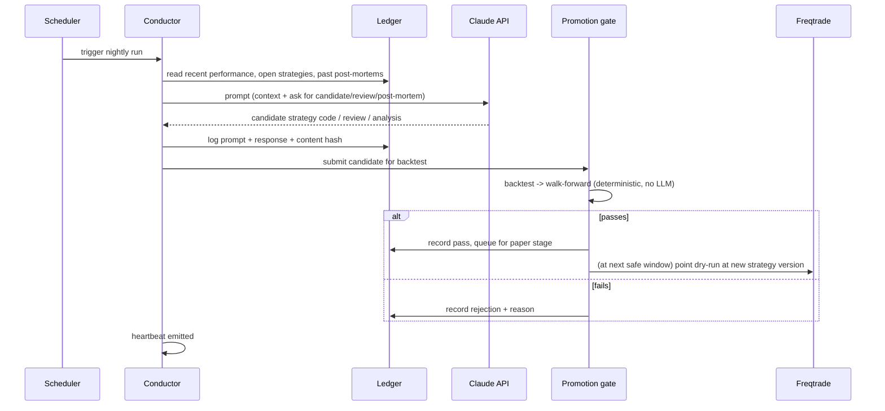
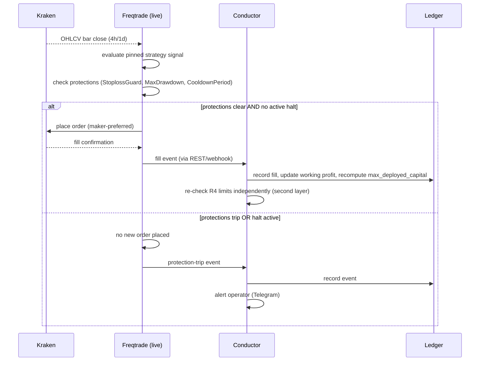
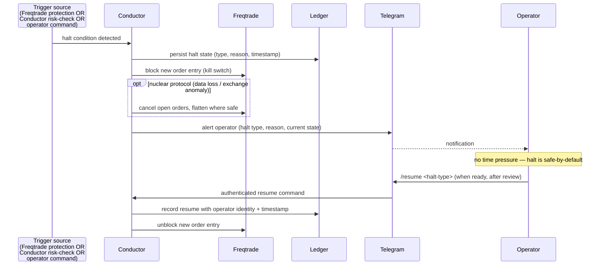

# Architecture — Data Flow

Three sequences that matter most: the nightly research loop, a live
trading tick, and a halt. All three are also drilled procedurally in
[`06-runbooks/`](../06-runbooks/).

## 1. Nightly research loop

Note: the LLM's output never reaches Freqtrade directly. It reaches the
Gate, which is deterministic code, and only a *pass* results in Freqtrade
being reconfigured — and only in dry-run at that point.

## 2. Live tick (bar close to ledger update)

## 3. Halt (trigger to human re-enable)

The critical property in all three diagrams: **the ledger is written
before or alongside the action it describes**, never after, so a crash
mid-sequence cannot leave the system in an undocumented state — see AC4.5.

## TBD

- Exact webhook vs. polling mechanism between Freqtrade and Conductor for
  fill events — TBD (Phase 3), re-tagged from "Phase 2/3" during Phase 2
  closure (Conductor is the consumer here and doesn't exist until Phase
  3; Freqtrade's REST API itself is already up in Phase 2, see
  `infra/README.md`), likely Freqtrade's REST API polled on a short
  interval plus its optional webhook feature.
- Retry/backoff behaviour for the Telegram alert path if Telegram itself
  is unreachable — TBD (Phase 3), candidate fallback: email or a second
  channel.
