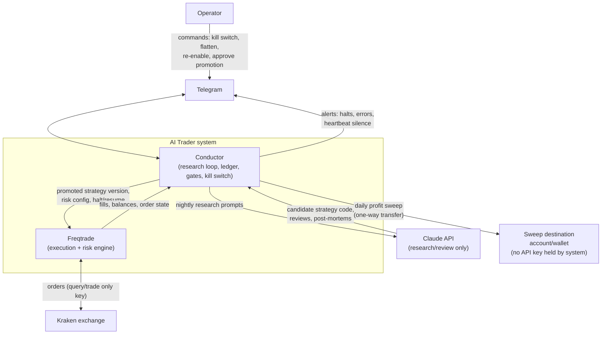
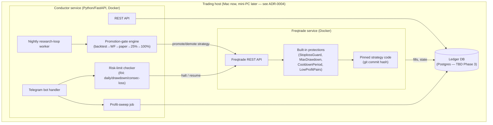

# Architecture — Overview

Two independent services, one deterministic and money-moving, one advisory
and read/propose-only, connected through a ledger both can read but only
Conductor writes decisions to.

## Context diagram

**Key invariant visible in this diagram:** Claude has no arrow to Kraken,
directly or indirectly through Freqtrade. Every arrow from Claude terminates
at Conductor, which treats it as a proposal, not a command. See
[`ADR-0003`](../05-adr/0003-llm-never-orders.md).

## Container diagram

## Design principles

1. **Two trust domains.** Anything Claude produces is a *proposal* that
   lives in the LLM/research domain until it passes deterministic gates
   into the execution domain. No code path collapses this boundary.
2. **The execution domain is boring on purpose.** Freqtrade's protections
   and its dry-run/live code-path parity are load-bearing — see
   [`execution-freqtrade.md`](execution-freqtrade.md).
3. **Every money-relevant fact lives in the ledger**, not in memory or in
   an LLM's context window. Restarting any service must never lose halt
   state, principal record, or promotion stage.
4. **Fail closed.** Any ambiguity (sweep failure, reconciliation mismatch,
   heartbeat silence) defaults to halting or blocking new risk, never to
   proceeding optimistically.

## Related documents

- [`conductor.md`](conductor.md) — research loop, ledger, gates, kill
  switch, Telegram in detail.
- [`execution-freqtrade.md`](execution-freqtrade.md) — Freqtrade
  configuration and dry-run/live handling.
- [`data-flow.md`](data-flow.md) — sequence diagrams for the nightly loop,
  a live tick, and a halt.
- [`security.md`](security.md) — key scopes, secrets, network.

## TBD

- Ledger DB engine (Postgres assumed; SQLite may suffice at this scale) —
  TBD (Phase 3).
- Exact container orchestration (`docker compose` assumed for Phase 1–4
  scale; no Kubernetes planned) — confirmed direction, formalized in
  [`infra/README.md`](../../infra/README.md) at Phase 2.
