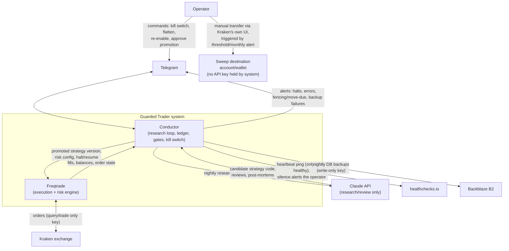
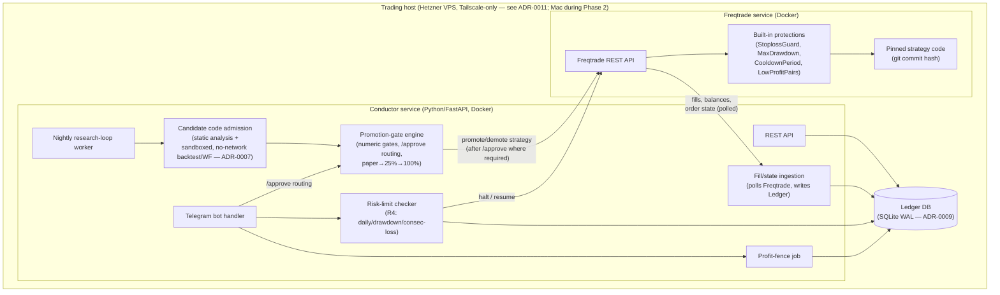

# Architecture — Overview

Two independent services, one deterministic and money-moving, one advisory
and read/propose-only, connected through a ledger both can read but only
Conductor writes decisions to.

## Context diagram

**Key invariant visible in this diagram:** Claude has no arrow to Kraken,
directly or indirectly through Freqtrade. Every arrow from Claude terminates
at Conductor, which treats it as a proposal, not a command. See
[`ADR-0003`](../05-adr/0003-llm-never-orders.md). A second invariant:
Conductor has no arrow to the sweep destination either — profit fencing is
a ledger-only operation inside Conductor, and the only path to the sweep
destination is the Operator acting manually via Kraken's own interface
(R3).

## Container diagram

## Design principles

1. **Two trust domains.** Anything Claude produces is a *proposal* that
   lives in the LLM/research domain until it passes deterministic gates
   into the execution domain. No code path collapses this boundary — and
   this covers the *code itself*, not just the trading decision it
   encodes: LLM-generated strategy code passes static analysis and runs
   only inside a throwaway, network-disabled sandbox (candidate code
   admission, [`ADR-0007`](../05-adr/0007-candidate-code-admission.md))
   before it is ever considered for even paper trading, let alone live
   capital.
2. **The execution domain is boring on purpose.** Freqtrade's protections
   and its dry-run/live code-path parity are load-bearing — see
   [`execution-freqtrade.md`](execution-freqtrade.md).
3. **Every money-relevant fact lives in the ledger**, not in memory or in
   an LLM's context window, and **only Conductor ever writes to it** —
   Freqtrade is polled for fills/state via its REST API and never given
   ledger write access, so there is exactly one writer to reconcile
   against. Restarting any service must never lose halt state, principal
   record, or promotion stage.
4. **Fail closed.** Any ambiguity (a missed fencing run, reconciliation
   mismatch, heartbeat silence) defaults to halting or blocking new risk,
   never to proceeding optimistically.

## Related documents

- [`conductor.md`](conductor.md) — research loop, ledger, gates, kill
  switch, Telegram in detail.
- [`execution-freqtrade.md`](execution-freqtrade.md) — Freqtrade
  configuration and dry-run/live handling.
- [`data-flow.md`](data-flow.md) — sequence diagrams for the nightly loop,
  a live tick, and a halt.
- [`security.md`](security.md) — key scopes, secrets, network.

## TBD

- ~~Ledger DB engine (Postgres assumed; SQLite may suffice at this
  scale)~~ — resolved: SQLite, see
  [`ADR-0009`](../05-adr/0009-sqlite-ledger.md).
- Exact container orchestration (`docker compose` assumed for Phase 1–4
  scale; no Kubernetes planned) — confirmed direction, formalized in
  [`infra/README.md`](../../infra/README.md) at Phase 2.
- Sandboxed runtime for candidate code admission (Docker-in-Docker vs. a
  pre-built, network-disabled base image) — TBD (Phase 3), re-tagged from
  "Phase 2/3" during Phase 2 closure (Conductor doesn't exist until Phase
  3), see
  [`ADR-0007`](../05-adr/0007-candidate-code-admission.md).
