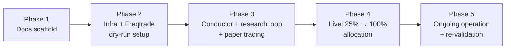

# 07 — Roadmap

Five phases, each with an explicit entry gate (what must be true to start)
and exit gate (what must be true to move on). No phase starts without a
written, human-approved plan (`CLAUDE.md` §1); no phase's exit gate is
waived silently.

## Phase 1 — Docs scaffold (this phase)

**Entry gate:** research review complete
(`docs/research/01-research-review.md`).

**Scope:** this repository's documentation structure, requirements, risk
register, ADRs, runbooks, licence. No code that connects to an exchange.

**Exit gate:**
- [ ] Every file in the target layout (`docs/phase-1-plan.md` §1) exists
      with real content.
- [ ] R1–R4 reviewed and confirmed by the operator
      (`docs/phase-1-plan.md` §5 checklist).
- [ ] Risk register has nothing the operator disagrees with.
- [ ] Draft paper exit criteria are numbers the operator would actually
      hold the system to.
- [ ] Single conventional commit made, `git init` done, `main` branch.

## Phase 2 — Infra + Freqtrade dry-run setup

**Entry gate:** Phase 1 exit gate met, **and** Kraken account residency
updated to Canada (Payward Canada) with Interac e-Transfer funding
available — see risk register T3. This must be true before any
live-adjacent setup in this phase (key creation, account configuration);
it is not itself a funding step — principal funding is a deliberate,
explicit Phase 4 action (see Phase 4 entry gate), not something this
phase triggers.

**Scope:**
- `infra/` docker-compose for Freqtrade (and a placeholder for Conductor,
  built out in Phase 3).
- Freqtrade configured against Kraken (query+trade-only key), dry-run
  mode only — no live trading in this phase.
- Resolve the Phase-2-tagged TBDs across the docs: Kraken min order
  sizes/fee tiers, quote currency (USD/CAD), disk encryption verification,
  pre-commit secret scanning, Tailscale setup, sleep-disable mechanism,
  dependency-update automation, protection threshold values, accountant
  consultation on tax classification (T1/T3/T4), CRA registration-status
  check. (Original plan, as written before Phase 2 began — see the exit
  gate below for what actually resolved this phase vs. what got re-tagged
  to Phase 3/4 during work package 2F's closure pass.)
- Historical OHLCV data pulled for backtesting (Freqtrade `download-data`
  — vs. a paid provider is research review open question §7.3, decide
  here).
- A first, simple strategy candidate (hand-written, not yet LLM-generated)
  running in dry-run, to validate the whole execution path end-to-end
  before Conductor exists.

**Exit gate — actual status as of 2026-09-09 (work package 2F close):**
- [ ] Freqtrade running in Docker, dry-run mode, against real Kraken
      market data, with at least one strategy live in paper mode, for
      **7 consecutive days** (sharpened from the original "at least one
      strategy live" wording to match `docs/phase-2-plan.md` §3's exit
      gate: "Freqtrade dry-run uptime ≥ 7 consecutive days"). **In
      progress** (work package 2D) — started `2026-09-09 17:46 UTC`
      (`make up`, confirmed via `Dry run is enabled` in logs and
      `"dry_run":true` on the REST API's `/show_config`). Expected to lose
      money on paper — the point of this run is host stability and path
      validation, not returns (see `docs/00-vision.md` "What Phase 2
      taught us"). 7-day mark: `2026-09-16 17:46 UTC`. Update this line
      when the uptime bar is actually met — no gaps from the host being
      down count toward it (mirrors the paper-window rule in
      `08-paper-exit-criteria.md`).
- [ ] All built-in protections (StoplossGuard, MaxDrawdown, CooldownPeriod,
      LowProfitPairs) configured with concrete thresholds, not TBDs.
      **3 of 4 done**: `CooldownPeriod`, `StoplossGuard`, `MaxDrawdown` are
      configured with concrete values in `Baseline4h.py`
      (`docs/04-architecture/execution-freqtrade.md`). `LowProfitPairs`
      is deliberately deferred to Phase 2D — it needs real trade history
      to set a meaningful threshold against, which doesn't exist for a
      strategy that has only been backtested so far.
- [ ] Key scoping verified (no withdrawal permission) per
      `docs/06-runbooks/key-rotation.md`. **Not applicable yet — no key
      exists.** Work package 2E (key creation) stays explicitly deferred
      pending Kraken account residency confirmation (risk register T3,
      `docs/phase-2-plan.md` §0); this checkbox cannot be completed before
      2E regardless of anything else in this phase, and that is expected,
      not a gap in this closure pass.
- [x] Secrets hygiene verified: `.gitignore` effective (confirmed);
      gitleaks pre-commit hook installed and active
      (`pre-commit install` run on the trading host, 2026-09-09 — not
      just configured in `.pre-commit-config.yaml`, actually installed
      this time); `pre-commit run gitleaks --all-files` run against the
      full repo and passed clean, 2026-09-09.
- [x] ~~Accountant consulted on tax classification; T1/T3/T4 in the risk
      register updated from Open/TBD to a concrete status.~~ **Re-scoped**
      during this closure pass: the actual consultation is re-tagged to
      block **Phase 4 entry** instead (risk register T1/T4 — Phase 2 is
      dry-run only, zero taxable events exist to consult about yet). What
      Phase 2 *can* deliver — the question list itself
      (`docs/09-tax-questions.md`) — is done. T3 (Kraken registration
      status) is unrelated to tax classification and blocks **2E
      specifically**, not this checkbox.

**Net: Phase 2 exit gate is not yet met.** Two items are genuinely
outstanding — the 7-day dry-run uptime (2D, starting now) and key scoping
(blocked on 2E, itself blocked on external Kraken residency status, not
on anything this repo controls). Protections are 3/4 done by design, not
by omission. Secrets hygiene is fully done. Tax classification was
deliberately moved off this gate entirely, onto Phase 4's.

## Phase 3 — Conductor + research loop + paper trading

**Entry gate:** Phase 2 exit gate met.

**Scope:**
- Conductor service: ledger, promotion-gate engine, risk-limit checker
  (independent second layer for R4), profit-fence job, Telegram bot.
- Nightly research loop wired to Claude, full prompt/response logging.
- `docs/08-paper-exit-criteria.md` finalized with concrete numbers before
  the first strategy is evaluated against them.
- At least one strategy taken through backtest → walk-forward → 3-week
  paper against the finalized exit criteria.
- Sweep destination account/wallet established (no API key issued to the
  running system) and the fence-then-manual-move flow drilled per
  `docs/06-runbooks/profit-sweep.md`.
- Kill switch and nuclear protocol drilled (simulated, in dry-run) per
  their runbooks — not just written, actually exercised.

**Exit gate:**
- [ ] At least one strategy meets every numeric criterion in
      `docs/08-paper-exit-criteria.md`.
- [ ] Zero risk-engine violations, zero unhandled halts across the full
      3-week paper window.
- [ ] Kill switch and nuclear protocol drills completed successfully.
- [ ] Ledger produces a CAD-equivalent, tax-report-ready export (NFR6),
      reviewed with the accountant from Phase 2.
- [ ] Heartbeat/alerting verified working, including the "host down"
      failure mode (independent watchdog).

## Phase 4 — Live: 25% → 100% allocation

**Entry gate:** Phase 3 exit gate met. Explicit, deliberate human decision
to fund the account with the $100 principal (R1) and go live — this is
not an automatic transition.

**Scope:**
- Live trading begins at 25% of `max_deployed_capital`, real orders,
  real money.
- Migration to a dedicated mini-PC per
  `docs/06-runbooks/migrate-to-minipc.md` — trigger condition TBD (see
  `docs/05-adr/0004-mac-first-minipc-later.md`), expected to happen within
  this phase.
- Scale to 100% allocation once the 25% stage is stable — stability
  criteria TBD (Phase 4, to be defined before the 25% stage begins, not
  during it).
- "Planned absence" procedure for the operator (risk register O6).

**Exit gate:**
- [ ] Running at 100% allocation.
- [ ] No breach of R1–R4 at any point during the 25%→100% transition.
- [ ] Migration to mini-PC (or an explicit decision to defer it, with
      reasoning recorded) complete.
- [ ] At least one full re-validation cycle (Phase 5 cadence) completed
      successfully while live.

## Phase 5 — Ongoing operation + re-validation

**Entry gate:** Phase 4 exit gate met.

**Scope:**
- Strategies re-validated every 4–6 weeks (research review §4); demoted
  back to paper on failure, per the promotion pipeline
  (`docs/04-architecture/conductor.md`).
- Regular risk-register review at each cycle.
- Periodic reassessment of framework choice (revisit NautilusTrader once
  its v2 has 2–3 stable releases — research review D5) and of whether
  qanat/vectorbt earn a place in the research sandbox (D6) — neither is on
  the critical path.
- Full, ongoing public reporting of results — win or lose — per
  `docs/00-vision.md` success criteria.

**Exit gate:** N/A — this is the steady state. The project ends (or is
explicitly re-scoped, e.g. principal change, org transfer to Aplicy) by
deliberate decision, not by drift.

## TBD summary

Phase 2 (as of work package 2F close, 2026-09-09): resolved this
phase — ~~quote currency~~ (ADR-0008), ~~min order sizes~~
(`docs/research/02-kraken-market-facts.md`), ~~disk encryption~~
(FileVault confirmed On), ~~secret scanning tool~~ (gitleaks, installed
and active), ~~sleep-disable mechanism~~ (Amphetamine,
`infra/README.md`), ~~protection thresholds~~ (3 of 4, see Phase 2 exit
gate above). Genuinely still open: Tailscale (not yet installed — device
action, not blocking Phase 2 exit), dependency automation (re-tagged
Phase 3 — no remote/manifest to point it at yet), Kraken CA registration
status (external, blocks 2E specifically). Tax classification moved off
Phase 2 entirely, re-tagged to block Phase 4 entry (question list ready:
`docs/09-tax-questions.md`). Phase 3: ledger DB engine (resolved early —
~~SQLite~~, ADR-0009), heartbeat interval,
daily/drawdown/consecutive-loss exact thresholds, promotion-approval
stages, backup schedule. Phase 4: mini-PC migration trigger, 25%→100%
stability criteria, planned-absence procedure.
