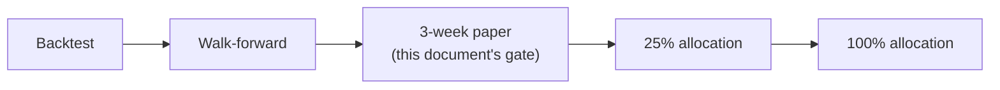

# 08 — Paper-trading exit criteria

This document is the numeric contract for "a strategy is allowed to touch
real money." It expands the draft in `docs/phase-1-plan.md` §3 into a
gated, testable set of criteria. **Values marked draft below are inputs to
Phase 3 finalization** — they are the operator's current best judgement
from the research review, not yet exercised against real paper-trading
data. They must be reviewed and either confirmed or revised, in writing
(a doc update, not a silent code change), before the first strategy is
evaluated against them.

## Where this sits in the pipeline

See `docs/04-architecture/conductor.md` for the full pipeline and
`docs/02-requirements.md` R4 for the loss-limit requirements this gate
inherits.

## Gate 1 — Backtest → Walk-forward (pre-paper)

A candidate strategy must pass this gate before it is even eligible for
the 3-week paper stage:

| Criterion | Threshold (draft) | Rationale |
|---|---|---|
| Tunable parameters | ≤ 6 | Overfitting defence, research review §4 / NFR5 |
| Walk-forward method | Anchored **and** rolling, both run | Research review §4 |
| Out-of-sample Sharpe vs. in-sample Sharpe | OOS ≥ 50% of IS | Research review §4 (reject if below) |
| Backtest fee/slippage assumptions | ≥ live-observed Kraken taker fee (~0.26%) plus a slippage buffer — exact buffer TBD (Phase 2/3) | Avoid over-optimistic backtests (M4, M5 in risk register) |
| Minimum backtest history | TBD (Phase 3) — enough bars at 4h/1d resolution to cover at least one full market regime | Regime-shift defence (M5) |

## Gate 2 — 3-week paper (dry-run)

A strategy that reaches this stage runs in Freqtrade dry-run, against real
market data, for a minimum continuous window. All of the following must
hold **simultaneously** by the end of the window:

| Criterion | Threshold (draft) | Notes |
|---|---|---|
| Minimum duration | ≥ 3 continuous weeks | No gaps from the host being down — a period with a monitoring outage does not count toward the 3 weeks even if trading continued (data-quality concern) |
| Minimum closed trades | ≥ 20 | Enough sample size to say anything statistically meaningful at this trade frequency |
| Net P&L after fees | > 0 | Must be profitable net of realistic fees, not just gross |
| Max drawdown during the window | < 10% | Same threshold as the live max-drawdown halt (R4 AC4.2) — a strategy that would trip its own live halt during paper has not really passed |
| Fee ratio (fees / gross profit) | < 40% | Directly targets the fee-drag failure mode (research review §1, §3) |
| Risk-engine violations | 0 | Any breach of daily loss limit, drawdown, or consecutive-loss breaker during the paper window is disqualifying, not just noted |
| Unhandled halts | 0 | A halt that required manual intervention beyond the documented runbooks disqualifies the run |
| LLM proposal logging | 100% of proposals in the window logged and replayable | NFR1 — verifies auditability actually works, not just that it's designed |

If **any** criterion fails, the strategy does not advance. It may be
returned to the research loop for revision (a new candidate, re-entering
at Gate 1) — a failed paper run does not get a second chance at the same
code without going back through backtest/walk-forward again.

## Gate 3 — 25% → 100% allocation

**TBD (Phase 4).** Stability criteria for scaling from 25% to 100%
allocation must be defined *before* the 25% stage begins (per
`docs/07-roadmap.md` Phase 4 entry gate), not decided mid-stage. Expected
to mirror Gate 2's structure (minimum duration live, minimum trades, net
P&L, drawdown, zero risk-engine violations) applied to live rather than
paper data, likely with a shorter minimum duration since live data at 25%
allocation is a stronger signal than paper data. Not fixed now to avoid
setting numbers before any live data exists to sanity-check them against.

## Demotion criteria (ongoing, Phase 4+)

A strategy that has reached live allocation is demoted back to paper if,
on the Phase 5 re-validation cadence (every 4–6 weeks) or at any point in
between:

- OOS Sharpe on a re-run walk-forward falls below 50% of its original IS
  Sharpe (same threshold as Gate 1, re-applied).
- Live fee ratio exceeds the Gate 2 threshold (40%) over a trailing
  window — TBD (Phase 4) exact trailing-window length.
- It triggers a max-drawdown or consecutive-loss halt (R4) — automatic
  demotion pending review, not automatic re-promotion.

## Why these specific numbers (and why they might be wrong)

Every threshold here is derived from the research review's documented
evidence (fee economics, overfitting defence, drawdown limits already
required by R4) rather than picked arbitrarily — but none of them have
been validated against this system's own live paper data yet, because
none exists at Phase 1. The Phase 1 review checklist
(`docs/phase-1-plan.md` §5) explicitly asks the operator to confirm these
are numbers they would actually hold the system to before Phase 3 begins.
If Phase 3 experience shows a threshold is unrealistic (e.g. 20 trades in
3 weeks is not achievable at 4h/1d frequency with 2–3 positions), that is
a documented revision to this file, not a threshold quietly ignored.

## TBD summary

- Exact backtest fee/slippage buffer (Gate 1).
- Minimum backtest history length (Gate 1).
- Full Gate 3 (25%→100%) criteria (Phase 4).
- Demotion trailing-window length (Phase 4).
- `daily_profit_cap`, `daily_loss_limit`, `max_drawdown`,
  `consecutive_loss_limit` exact values — tracked in
  `docs/02-requirements.md` R3/R4, finalized alongside this document in
  Phase 3.
