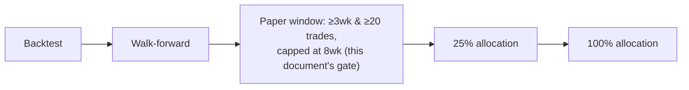

# 08 — Paper-trading exit criteria

This document is the numeric contract for "a strategy is allowed to touch
real money." It expands the draft in `docs/phase-1-plan.md` §3 into a
gated, testable set of criteria. **Values marked draft below are inputs to
Phase 3 finalization** — they are the operator's current best judgement
from the research review, not yet exercised against real paper-trading
data. They must be reviewed and either confirmed or revised, in writing
(a doc update, not a silent code change), before the first strategy is
evaluated against them.

## Where this sits in the pipeline

See `docs/04-architecture/conductor.md` for the full pipeline and
`docs/02-requirements.md` R4 for the loss-limit requirements this gate
inherits.

## Gate 1 — Backtest → Walk-forward (pre-paper)

A candidate strategy must pass this gate before it is even eligible for
the paper window stage:

| Criterion | Threshold (draft) | Rationale |
|---|---|---|
| Tunable parameters | ≤ 6 | Overfitting defence, research review §4 / NFR5 |
| Walk-forward method | Anchored **and** rolling, both run | Research review §4 |
| In-sample Sharpe (absolute floor) | ≥ 1.0, **computed on the daily-equity-curve basis** (Freqtrade's "Sharpe (daily wallet balance)" figure, not its trade-return-distribution "Sharpe (closed trades)" figure) | Required **before** the ratio test below is even applied. The OOS/IS ratio is meaningless when IS Sharpe is negative or near zero — a strategy with IS Sharpe 0.05 trivially "passes" a 50%-of-IS test with an OOS Sharpe of 0.03, which is not evidence of anything. A strategy that never demonstrated a real in-sample edge doesn't get to the ratio question at all. The basis is pinned explicitly because the work package 2C review found the two Freqtrade Sharpe figures gave materially different pass/fail answers on a short sample (0.97 vs. 1.81 — one under the floor, one over) — that ambiguity is not acceptable in a go/no-go gate. Daily-equity basis is chosen because it is time-weighted (reflects actual equity-curve smoothness/risk over the window) rather than an unweighted distribution over trade returns, which a low trade count can distort heavily. |
| Out-of-sample Sharpe vs. in-sample Sharpe | OOS ≥ 50% of IS (only evaluated once IS Sharpe ≥ 1.0 above), **same daily-equity-curve basis as above** | Research review §4 (reject if below) |
| Backtest fee/slippage assumptions | ≥ live-observed Kraken taker fee (~0.26%) plus a slippage buffer — exact buffer TBD (Phase 2/3) | Avoid over-optimistic backtests (M4, M5 in risk register) |
| Minimum backtest history | TBD (Phase 3) — enough bars at 4h/1d resolution to cover at least one full market regime | Regime-shift defence (M5) |
| No single-trade dominance | No single trade, and no force-exit group (see below) taken as a whole, may account for more than 30% of net profit | A strategy whose entire reported edge rides on one trade (or one favourable data cutoff) hasn't demonstrated a repeatable edge — it has demonstrated one lucky outcome dressed up in a headline P&L number. **The work package 2C review found the original run failed this outright**: its 3 force-exit trades totalled $20.01 against a $18.44 reported net profit (108.6% — the force-exit group alone exceeded the *entire* net profit figure), and the single largest trade in that run ($11.09, SOL/USD, one of those force-exit trades) was 60.2% of net profit on its own. Neither would have been visible from the net P&L figure alone. |

**Force-exit trades and headline net P&L.** A trade still open when the
backtest data window ends is closed by the backtesting engine itself
(`exit_reason: force_exit`), not by the strategy's own entry/exit logic —
it is an artifact of where the data happens to stop, not evidence about
the strategy. **Force-exit trades are therefore excluded from the
headline net P&L figure used to evaluate every criterion in this gate,
and reported as a separate line item instead** (count, total profit,
per-trade detail). A strategy's Gate 1 net P&L, Sharpe, and drawdown are
all computed on the trade population the strategy actually chose to close
by itself. This is not optional cosmetics: the work package 2C short-window
run had 3 force-exit trades totalling more profit than the entire
reported net P&L figure — without this rule, a favourable data cutoff
alone could make an otherwise-losing strategy look profitable.

## Gate 2 — Paper window (dry-run)

A strategy that reaches this stage runs in Freqtrade dry-run, against real
market data. Unlike Gate 1 and Gate 3, this stage does not use a single
fixed duration — see **Window**, below, chosen deliberately to avoid
incentivising over-trading just to hit a sample-size target, which is the
exact failure mode the research review documents (§3: over-trading and fee
drag were the dominant causes of loss in every live LLM-agent experiment
reviewed).

### Window

The paper window runs until **both** of the following are true, **or**
**8 weeks** have elapsed — whichever comes first:

- At least **3 continuous weeks** have passed. No gaps from the host being
  down count toward this — a period with a monitoring outage does not
  count even if trading continued underneath it (data-quality concern).
- At least **20 trades** have closed.

**If both are met before 8 weeks:** the window ends there, and the
strategy is evaluated against the criteria below.

**If 8 weeks elapse and 20 trades have not been reached:** the window
still ends at 8 weeks. The strategy is evaluated on whatever trades it
actually closed. A low trade count at that point is **recorded as a fact
about the strategy** (e.g. "this strategy trades roughly once every N days
at this frequency") — it is **not** itself a failure condition, and the
criteria below are evaluated on the smaller sample rather than waiting
indefinitely for a bigger one. Deliberately: nothing in this gate rewards
trading more just to reach a number.

### Criteria

All of the following must hold, evaluated at the end of the window as
defined above:

| Criterion | Threshold (draft) | Notes |
|---|---|---|
| **Backtest consistency** (primary evidence of validity) | Paper trade count, win rate, average trade duration, and max drawdown all fall within the range predicted by Gate 1's walk-forward run — exact tolerance/range definition TBD (Phase 3) | The strongest evidence this gate produces — see rationale below. If paper behaviour diverges materially from what walk-forward predicted, that is disqualifying **even if P&L happens to be positive**: a strategy that "got lucky" in a way inconsistent with its own model hasn't demonstrated anything. |
| Net P&L after fees (floor, not primary evidence) | > 0 | Must be profitable net of realistic fees — but see rationale below for why this alone is a weak signal at this sample size. |
| Max drawdown during the window | < 10% | Same threshold as the live max-drawdown halt (R4 AC4.2) — a strategy that would trip its own live halt during paper has not really passed |
| Fee ratio (fees / gross profit) | < 40% | Directly targets the fee-drag failure mode (research review §1, §3) |
| Risk-engine violations | 0 | Any breach of daily loss limit, drawdown, or consecutive-loss breaker during the paper window is disqualifying, not just noted |
| Unhandled halts | 0 | A halt that required manual intervention beyond the documented runbooks disqualifies the run |
| LLM proposal logging | 100% of proposals in the window logged and replayable | NFR1 — verifies auditability actually works, not just that it's designed |

If **any** criterion fails, the strategy does not advance. It may be
returned to the research loop for revision (a new candidate, re-entering
at Gate 1) — a failed paper run does not get a second chance at the same
code without going back through backtest/walk-forward again.

## Gate 3 — 25% → 100% allocation

**TBD (Phase 4).** Stability criteria for scaling from 25% to 100%
allocation must be defined *before* the 25% stage begins (per
`docs/07-roadmap.md` Phase 4 entry gate), not decided mid-stage. Expected
to mirror Gate 2's structure (minimum duration live, minimum trades, net
P&L, drawdown, zero risk-engine violations) applied to live rather than
paper data, likely with a shorter minimum duration since live data at 25%
allocation is a stronger signal than paper data. Not fixed now to avoid
setting numbers before any live data exists to sanity-check them against.

## Demotion criteria (ongoing, Phase 4+)

A strategy that has reached live allocation is demoted back to paper if,
on the Phase 5 re-validation cadence (every 4–6 weeks) or at any point in
between:

- Re-run in-sample Sharpe falls below 1.0, or OOS Sharpe on a re-run
  walk-forward falls below 50% of its (re-run) IS Sharpe — same two-part
  threshold as Gate 1, re-applied.
- Live fee ratio exceeds the Gate 2 threshold (40%) over a trailing
  window — TBD (Phase 4) exact trailing-window length.
- It triggers a max-drawdown or consecutive-loss halt (R4) — automatic
  demotion pending review, not automatic re-promotion.

## Why these specific numbers (and why they might be wrong)

Every threshold here is derived from the research review's documented
evidence (fee economics, overfitting defence, drawdown limits already
required by R4) rather than picked arbitrarily — but none of them have
been validated against this system's own live paper data yet, because
none exists at Phase 1. The Phase 1 review checklist
(`docs/phase-1-plan.md` §5) explicitly asks the operator to confirm these
are numbers they would actually hold the system to before Phase 3 begins.
If Phase 3 experience shows a threshold is unrealistic (e.g. 20 trades is
not achievable within 8 weeks at 4h/1d frequency with 2–3 positions), that
is a documented revision to this file, not a threshold quietly ignored.

**Why "backtest consistency" is the primary criterion, not net P&L.** A
3-week-to-8-week paper window, at low-frequency trading, produces at most
a few dozen trades — a genuinely weak sample to judge profitability from
on its own. A strategy can show positive P&L over that window by chance,
and a strategy can show negative P&L over that window while still behaving
exactly as its walk-forward validation predicted (a losing streak within
an expected distribution is not evidence of a broken strategy). Net P&L is
kept as a **floor** — a strategy that loses money in paper does not
advance, full stop — but the criterion that actually tells us whether the
strategy is *doing what we think it's doing* is whether its observed
trade count, win rate, trade duration, and drawdown fall inside the range
its own walk-forward run predicted. Consistency-with-model is the stronger
signal at this sample size; a short window of P&L is the weaker one.

## TBD summary

- Exact backtest fee/slippage buffer (Gate 1).
- Minimum backtest history length (Gate 1).
- Exact tolerance/range definition for the "Backtest consistency" check
  (Gate 2) — TBD (Phase 3).
- Full Gate 3 (25%→100%) criteria (Phase 4).
- Demotion trailing-window length (Phase 4).
- `daily_profit_cap`, `manual_move_threshold`, `daily_loss_limit`,
  `max_drawdown`, `consecutive_loss_limit`, `monthly_llm_budget` exact
  values — tracked in `docs/02-requirements.md` R3/R4/R6, finalized
  alongside this document in Phase 3.
