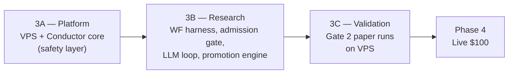
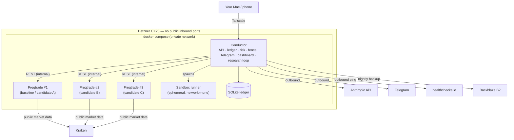

# Phase 3 — VPS, Conductor, Research Loop, Paper Validation

**Repo:** `~/workspace/ai-trading-agent` · **Status:** Draft for review · **Date:** 2026-10-04
**Goal:** Move off the Mac to a hardened VPS, build Conductor (our safety + control layer), add the LLM research loop behind deterministic gates, and take at least one candidate strategy through Gate 2 paper validation.
**Out of scope:** real money (Phase 4), withdrawal-capable keys (never).

---

## 0. Structure

Phase 3 is split into three sub-phases, each with its own exit gate. Nothing LLM-generated runs until the safety layer around it is proven.

| Sub-phase | Delivers | Test subject | Rough effort (3 h/day) |
|---|---|---|---|
| 3A | VPS, ledger, R1–R5 enforcement, kill switch, Telegram, dashboard, heartbeat | Baseline4h (known no-edge) | 2–3 weeks |
| 3B | Backtest/walk-forward harness, code admission, research loop, promotion engine | LLM candidates | 2–3 weeks |
| 3C | Paper validation against Gate 2 | Best 1–3 candidates | 3–8 weeks (wall clock, low effort) |

---

## 1. Decisions to lock

| # | Item | Recommendation | Why |
|---|---|---|---|
| D1 | Host | **Hetzner Cloud CX23** (2 vCPU, 4 GB, 40 GB; CX22 was withdrawn from sale 2026-01-01, same specs — see ADR-0011), EU region (Nuremberg/Falkenstein) | Cheapest reliable option (~€4–5/mo). Correction to earlier note: the CX line is EU-only; US regions use the pricier CPX line. Latency is irrelevant at 4h. Supersedes ADR-0004 → **ADR-0011** |
| D2 | OS | Ubuntu 24.04 LTS | Long support, Docker-native |
| D3 | Provisioning | Terraform (`hcloud` provider) + cloud-init | Reproducible, rebuildable from zero, fits your stack |
| D4 | Access | Tailscale only. Public firewall: **zero inbound ports** after bootstrap (SSH closed publicly once Tailscale is up) | Nothing to attack from the internet |
| D5 | Secrets | `.env` on VPS, `0640 root:deploy` (so the deploy user's `docker compose` can read it), never in git; mirrored in LastPass | Simple; Vault is overkill at this scale |
| D6 | Backups | Nightly SQLite backup (ledger + Freqtrade DBs) → Backblaze B2 (or Hetzner Storage Box), 30-day retention; weekly Hetzner snapshot | Ledger is the system of record |
| D7 | Deploy | `make deploy` from Mac over Tailscale: rsync/git pull + `docker compose up -d`. No CI/CD yet | One operator, low change rate |
| D8 | Conductor stack | Python 3.12, FastAPI, SQLAlchemy 2 + Alembic, SQLite (WAL), pydantic-settings, structlog, httpx, pytest | Matches ADR-0009 and existing Python toolchain |
| D9 | Dashboard | Inside Conductor: FastAPI + Jinja + HTMX + Chart.js, served on Tailscale only | No separate frontend build; good enough for one operator |
| D10 | Telegram | **Conductor owns the bot.** Freqtrade's own Telegram disabled | Fixes the command-restriction gap: Conductor exposes only allow-listed commands |
| D11 | Heartbeat | healthchecks.io free tier, push model | No inbound endpoint (already decided) |
| D12 | LLM access | **Anthropic API key with a hard monthly spend limit** set in the Console, plus R6 in-app budget. Sonnet for nightly runs, Opus for weekly review | Your Claude subscription does not cover API calls; the research loop needs its own metered key. Draft budget: $20/mo |
| D13 | Parallel paper runs | Up to 3 Freqtrade dry-run containers (one per candidate) | Directly attacks the low-trade-frequency problem from Phase 2 |

---

## 2. Target deployment

Freqtrade REST ports are reachable only on the internal Docker network. The dashboard is reachable only over Tailscale.

---

## 3. Work packages

Each package = one branch, plan mode first, one PR-equivalent merge to `main`.

### 3A — Platform (safety layer)

**3A-0 VPS provisioning** (`feat/vps-infra`) · Sonnet
- `infra/terraform/`: server, firewall (initially SSH from your IP only), SSH key, primary IPv4 (static — needed for Kraken key whitelist later).
- cloud-init: non-root deploy user, key-only SSH, root login disabled, `unattended-upgrades`, `fail2ban`, Docker Engine + compose plugin, Tailscale install.
- After Tailscale joins: firewall rule removed → zero public inbound.
- `make deploy`, `make ssh`, `make logs-remote`.
- Move Freqtrade dry-run from Mac to VPS; Mac becomes dev-only.
- Runbook `06-runbooks/rebuild-vps.md` (destroy → recreate → restore backup) — and actually drill it once.
- ADR-0011 (VPS supersedes Mac/mini-PC); update `migrate-to-minipc.md` → archived.

**3A-1 Conductor skeleton** (`feat/conductor-skeleton`) · Opus
- Clean architecture layout: `domain/` (capital, ledger, risk rules — pure, no I/O), `application/` (use cases), `adapters/` (Freqtrade REST, Telegram, healthchecks, Anthropic), `infrastructure/` (DB, config, scheduler).
- Alembic migrations, structlog JSON logs, health endpoint (internal), APScheduler for jobs.
- CI-equivalent: `make test`, `make lint` (ruff, mypy strict on `domain/`).

**3A-2 Ledger + capital rules** (`feat/ledger`) · Opus
- Ingest: poll each Freqtrade instance's REST for trades/orders → idempotent upsert into ledger (Conductor is the only writer).
- R1: principal record, immutable after first set.
- R2: `max_deployed_capital = principal + working_profit − fenced`, recomputed per ingest; enforced by writing Freqtrade's `available_capital` and calling `/reload_config`, plus pausing entries (`/stopentry`) if exposure would exceed.
- R3: daily UTC fence job (ledger-only); alert when fenced-but-unmoved ≥ $25 or monthly.
- R5: startup balance check (live mode only; no-op in dry-run, but tested with fixtures).
- NFR6: CAD fair-value per fill (Bank of Canada daily rate) for tax export.
- Unit tests for every money path; property tests for the capital formula.

**3A-3 Risk layer** (`feat/risk-layer`) · Opus
- R4 second layer: daily loss, drawdown from peak, consecutive losses — derived from the ledger, not from Freqtrade.
- **New: correlation guard** — BTC/ETH/SOL/LTC/XRP/LINK treated as one exposure group; cap total group exposure (draft: 2 concurrent positions or 66% of capital). Lesson from paper run: three positions were one bet.
- Halt state persisted; survives restarts; cleared only by authenticated human action.
- Kill switch (`/stopentry` all instances) and nuclear (cancel orders + `/forceexit` all + stop) via Freqtrade REST.

**3A-4 Telegram control surface** (`feat/telegram`) · Sonnet
- Disable Freqtrade Telegram in all configs.
- Conductor bot, chat-ID allowlist: `/status`, `/capital`, `/kill`, `/flatten`, `/resume <halt>`, `/approve <id>`, `/budget`.
- Destructive commands require a confirmation reply within 60 s.
- Alerts: halts, fills, fence events, move-due, missed jobs, budget 80%/100%.

**3A-5 Observability + dashboard** (`feat/observability`) · Sonnet — **implemented**; see ADR-0016 (backups), ADR-0017 (dashboard + Tailscale access), `docs/06-runbooks/restore-backup.md` and `provision-vps.md` steps 24-31.
- healthchecks.io ping every 5 min while healthy (`/fail` with a reason when not); alert on 15 min silence (period 5 min + grace 10 min).
- Dashboard (read-only, tailnet-only): **Overview** (principal / working / fenced / deployed, halt state, equity curve, last heartbeat and backup), **Positions & trades**, **Halts & audit log**. **Strategies & pipeline** (stage per candidate) and **Research runs** (prompt hash, cost, outcome) are placeholder pages until 3B produces data; approvals will show in the audit log from 3B-4.
- Nightly backup job (ledger + Freqtrade dry-run DB, write-only B2 key) + `scripts/restore-test.sh`.

**3A-6 Drills** (`chore/3a-drills`)
- Kill switch, nuclear, restart-persists-halt, heartbeat silence (stop container), backup restore, VPS rebuild. Results recorded in `docs/drills/`. Procedures, run order and results: [`docs/drills/README.md`](drills/README.md). `scripts/drill-check.sh` (on the VPS) verifies each step.

**3A exit gate**
- [ ] VPS running Freqtrade + Conductor ≥ 7 days, zero public inbound ports verified (external port scan). *(For the ADR-0019 live pilot only, this is replaced by a 72-hour clean soak from the 2026-10-05 rebuild; the 7 days still applies to everything else.)*
- [ ] All R1–R5 checks implemented with tests; R4 enforced in two layers
- [ ] Correlation guard active
- [ ] All six drills passed and recorded
- [ ] Dashboard + Telegram reachable from phone over Tailscale

### 3B — Research (LLM behind gates)

**3B-1 Backtest / walk-forward harness** (`feat/wf-harness`) · Opus
- Runs in an ephemeral container: `network=none`, read-only data mount, CPU/memory/time limits.
- Anchored + rolling walk-forward on Kraken's official archive, canonical timerange 2022-01-01 → 2026-10-01 (ADR-0020, superseding ADR-0010's Binance data).
- Computes every Gate 1 metric exactly as defined in `08-paper-exit-criteria.md`: daily-equity Sharpe, IS ≥ 1.0, OOS ≥ 50% IS, force-exit exclusion, 30% single-trade dominance, fee ratio, ≥ 100 trades over the canonical timerange, random-entry null, trial registry and Deflated Sharpe (ADR-0021 replaced the earlier "expected trades per 8 weeks ≥ 20" check).
- Output: machine-readable result JSON + human report.

**3B-2 Candidate code admission** (`feat/admission`) · Opus
- AST analysis: import allowlist (`pandas`, `numpy`, `talib`, `freqtrade.strategy`, `technical`), forbid `os`, `sys`, `subprocess`, `socket`, `requests`, `open`, `eval`, `exec`, `__import__`, dunder access.
- Structural rules: ≤ 6 tunable parameters; **must define profit-protection exit** (trailing stop, breakeven move, or time/ROI exit) — lesson from Baseline4h; long-only, no leverage; protections block present.
- Implements ADR-0007.

**3B-3 Research loop** (`feat/research-loop`) · Opus
- Nightly job: assemble context (recent ledger performance, regime summary, prior candidates + why they failed — a rejection memory, per FinMem), prompt Claude, receive strategy file + rationale.
- Prompt templates versioned in git; every prompt/response stored with SHA-256 hash (NFR1).
- Research brief hard constraints: 4h/1d, maker-preferred, profit protection required, fee-aware at Kraken Tier-1 taker cost (0.80% + 0.10% slippage per side); no trades-per-8-weeks target (ADR-0021).
- R6 budget: per-run token estimate, 80% alert, 100% pause (trading unaffected).
- Weekly Opus review run: critique of the week's candidates and live/paper behaviour.

**3B-4 Promotion engine** (`feat/promotion`) · Opus
- State machine: `proposed → admitted → backtested → walk-forward → awaiting_approval → paper → (live_25 → live_100 in Phase 4) / rejected / demoted`.
- `/approve` required before first paper entry of any new code version (ADR-0007).
- Paper slot allocation across the 3 Freqtrade containers; each candidate's strategy file pinned by git hash.

**3B exit gate**
- [ ] Harness reproduces the Baseline4h 2y result (−2.81%) within rounding — proves it's computing correctly
- [ ] Admission gate rejects a fixture set of malicious/invalid strategies (100% catch rate on the suite)
- [ ] ≥ 10 LLM candidates generated end-to-end with full logging, within budget
- [ ] ≥ 1 candidate passes Gate 1, or a documented decision on why none did

### 3C — Validation

- Up to 3 candidates in parallel paper on the VPS, evaluated against Gate 2 (window until ≥ 3 weeks and a 20-trade fill-rate sample, capped at 8 weeks; backtest-consistency primary; ADR-0021).
- `08-paper-exit-criteria.md` numbers frozen before the first candidate starts.
- Weekly review by you (dashboard + Telegram summary); no parameter changes mid-window.
- In parallel: API key creation (2E) — Query + Trade, no Withdraw, IP-whitelisted to the VPS static IP; stored only on VPS `.env` + LastPass. Still dry-run.

**Phase 3 exit gate = Phase 4 entry gate**
- [ ] ≥ 1 strategy passes Gate 2 in full
- [ ] Zero risk-engine violations, zero unhandled halts in the window
- [ ] Tax export reviewed with accountant
- [ ] Kraken key created and scope-verified
- [ ] Explicit human go/no-go decision recorded

If nothing passes Gate 2 after two research cycles, that is a valid outcome: document it, and decide between continuing research, changing asset/timeframe assumptions, or stopping. Not an excuse to loosen gates.

---

## 4. Running costs

| Item | Monthly |
|---|---|
| Hetzner CX23 + snapshots | ~€5–6 |
| Backblaze B2 backups | < $1 |
| healthchecks.io, Tailscale, Telegram | $0 |
| Anthropic API (R6 cap, draft) | ≤ $20 |
| **Total** | **≈ $30 CAD** |

Note for the vision doc: monthly running cost is ~30% of the principal. The experiment must eventually beat its own compute bill, or it remains a learning project — which is fine, but should be stated honestly.

---

## 5. New/updated docs
- ADR-0011 VPS hosting (supersedes 0004) · ADR-0012 Conductor owns Telegram · ADR-0013 correlation guard · ADR-0014 parallel paper instances
- Requirements: R7 correlation guard; R2 enforcement mechanism (`available_capital` + reload)
- Runbooks: rebuild-vps, restore-backup, deploy; archive migrate-to-minipc
- Risk register: VPS compromise, provider outage, API key leak via VPS, backup loss

---

## 6. Your review points
1. Hetzner EU (CX22, cheapest) vs US (CPX, ~2× price) — EU fine?
2. Anthropic API with a $20/mo hard cap — acceptable?
3. Correlation guard draft (max 2 concurrent positions in the crypto group) — too strict?
4. Up to 3 parallel paper candidates — agree?
5. Any work package you want reordered or cut?
