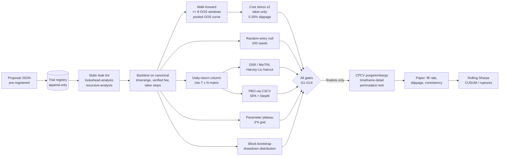

# Validation Upgrades: Making the Gates Honest About Multiple Testing, Costs and Leakage

Purpose: concrete, costed improvements to the backtest and walk-forward gates of the Freqtrade system, each with an algorithm sketch, the Freqtrade inputs it needs, a threshold, an effort estimate, a library with licence, and why it matters for a $20–$100 account fed by a nightly LLM loop.
Date: 2026-10-14
How to read the grades: **A** = primary paper or official documentation. **B** = maintained open-source docs or practitioner post citing primaries. **C** = forum, aggregator or uncited practitioner convention. Thresholds marked `TBD` have no published calibration for this setting and are operator judgement calls.

---

## Why the current gates are not enough

The current gates (anchored + rolling walk-forward, IS daily-equity Sharpe ≥ 1.0, OOS ≥ 50% of IS, no trade > 30% of profit, ≥ 20 trades in 8 weeks, fee ratio < 40%, ≤ 6 parameters, force-exits excluded) have three structural holes. First, none of them knows how many candidates have been tried: once a few hundred have been scored, the expected *best* in-sample Sharpe of pure noise is ≈ 1.66 annualised at N = 300 and ≈ 1.86 at N = 1,000 (for a cross-trial dispersion of 0.03/day), so the IS ≥ 1.0 gate selects noise ([Bailey & López de Prado](https://papers.ssrn.com/abstract=2460551); formulas as implemented in [endgame](https://endgame-ml.readthedocs.io/en/latest/_modules/endgame/utils/sharpe.html)). Second, the fee the gates were calibrated to (0.16/0.26) conflicts with the official Kraken Tier-1 schedule fetched on the research date (0.40/0.80) ([Kraken fee schedule](https://www.kraken.com/features/fee-schedule)); every gate must be re-run at the verified fee, and Freqtrade must be told that fee explicitly because its default is the ccxt market fee ([Freqtrade backtesting](https://www.freqtrade.io/en/stable/backtesting/)). Third, no gate separates the entry signal's contribution from BTC beta and exit timing, which in a long-only system is most of any backtest's return.

---

## 1. Trial registry and pre-registration (prerequisite for everything else)

**What.** An append-only store in which every candidate is written *before* its result is known and never deleted. The multiple-testing literature is explicit: "researchers must disclose all trials," hiding trials "will lead to an underestimation of the overfit," and guided searches "should contribute only their final outcomes, not intermediate steps" ([Bailey, Borwein, López de Prado & Zhu](https://www.davidhbailey.com/dhbpapers/backtest-prob.pdf)). The one leakage-safe LLM-strategy audit found that logging every evaluation and using that count as the deflation input was the control that mattered ([Gençay](https://arxiv.org/pdf/2608.27734)).

**Sketch.** SQLite or Parquet with columns: `trial_id`, `created_at`, `strategy_hash` (source + params + config + Freqtrade version + data snapshot id), `prompt_hash`, `response_hash`, `hypothesis_text` (written before backtest), `family`, `canonical_timerange`, `n_params`, `hyperopt_epochs`, `is_sharpe_daily`, `oos_sharpe_daily`, `n_trades`, `fee_ratio`, `daily_returns` (array on the canonical timerange), `parent_trial_id`, `status` (proposed / rejected / scored / finalist / paper / live). One `strategy_hash` scored on the canonical timerange = one trial; a hyperopt run = one trial for DSR's N with all epochs stored for an optional stricter PBO; each walk-forward protocol variant = another trial.

**Inputs from Freqtrade.** Backtest trade export (`user_data/backtest_results`) converted to a daily-return vector by allocating each trade's P&L to its close day (or pro-rata across holding days); `hyperopt-list --export-csv` for epochs.

**Threshold.** None; this is the input to the thresholds below. Fix one canonical evaluation timerange that contains the 2022 bear and the Nov 2025–2026 drawdown (see `01` §Q1 market context).

**Effort.** 4–8 h. **Compute.** Nil. **Library.** SQLite/pandas (BSD/PSF).

**Why at this scale.** A nightly loop produces N ≈ 365 trials a year with zero marginal cost; without the registry every other statistic in this file is computed against an unknown N and is meaningless.

---

## 2. Deflated Sharpe Ratio and minimum track record length

**What.** DSR is the probabilistic Sharpe ratio evaluated against the expected maximum Sharpe of N noise trials, with non-normality corrections ([Bailey & López de Prado 2014](https://papers.ssrn.com/abstract=2460551)).

**Sketch** (per-period Sharpe, T periods, as in the [endgame implementation](https://endgame-ml.readthedocs.io/en/latest/_modules/endgame/utils/sharpe.html)):
- `sr_std = sqrt((1 − skew·SR + ((kurt−3)+2)/4 · SR²) / (T−1))`
- `PSR(SR*) = Φ((SR − SR*) / sr_std)`
- `E[max SR] = σ_trials · [(1−γ)·Φ⁻¹(1−1/N) + γ·Φ⁻¹(1−1/(N·e))]`, γ = 0.5772
- `DSR = PSR(SR* = E[max SR])`
- `MinTRL = 1 + (Φ⁻¹(conf)/(SR − SR*))² · (1 − skew·SR + ((kurt−3)+2)/4·SR²)`, infinite if SR ≤ SR*.
Cross-check with the Harvey–Liu haircut: t = SR·√T, adjust p for N via BHY (`c(M) = Σ 1/j`, `p_adj(i) = min(p_adj(i+1), (M·c(M)/i)·p(i))`), back out the haircut Sharpe ([Harvey & Liu](https://www.cmegroup.com/content/dam/cmegroup/education/files/backtesting.pdf)). Effective N: cluster the registry's daily-return columns (hierarchical, correlation distance, cut ≈ 0.5) so near-duplicate LLM proposals do not inflate N; the cut height is uncalibrated ([Wikipedia DSR summary, C](https://en.wikipedia.org/wiki/Deflated_Sharpe_ratio)).

**Worked numbers for this project** (daily equity, 365 days/yr, σ_trials = 0.03/day): E[max SR] ≈ **1.66 annualised at N = 300** and **≈ 1.86 at N = 1,000**. A true annualised Sharpe of 1.0 needs MinTRL ≈ **992 days (2.7 y)** against SR* = 0 at 95%, and an infinite record against SR* = E[max SR]; a Sharpe of 2.0 against N = 300 needs ≈ 23 years. Harvey–Liu's example (SR 1.0, 120 months, N = 100, ρ = 0.4) haircuts 52% (BHY) to 75% (Bonferroni). Their t > 3 hurdle on 3 years of daily data corresponds to an annualised Sharpe of ≳ 1.73 *before* multiplicity correction ([Harvey, Liu & Zhu](https://www.nber.org/papers/w20592)).

**Inputs.** Champion's daily returns on the canonical timerange (T ≈ 700–1,500); registry N and σ_trials.

**Threshold.** No source calibrates a DSR threshold for a solo nightly loop. The generic convention is DSR ≥ 0.95, which is unpassable with 2–4 years of data once N is in the hundreds. Recommendation: report DSR, raw t, BHY-haircut Sharpe and MinTRL on every candidate; gate at **DSR ≥ 0.80 and BHY-haircut Sharpe ≥ 0.5** as a `TBD` operator setting; keep N honest and small by collapsing duplicates and by pre-registering few hypotheses (pre-registration "faces little deflation" ([Gençay](https://arxiv.org/pdf/2608.27734))).

**Effort.** 4–6 h (DSR) + 2–3 h (haircut port of the [quantstrat sandbox R code](https://rdrr.io/github/braverock/quantstrat/src/sandbox/Harvey_Liu_Backtesting/50a170e4e37da951ea1192888418c82a/Haircut_SR%20with%20sample_random_multests.R)). **Compute.** Milliseconds. **Library.** SciPy (BSD). Avoid `pypbo` (AGPL-3.0, TODO list unfinished, no visible release date ([GitHub](https://github.com/esvhd/pypbo))) — the formulas are ~60 lines.

**Why at this scale.** It is the only gate that knows the loop has been trying; without it the IS Sharpe gate is a noise filter with the sign reversed.

---

## 3. Probability of Backtest Overfitting (CSCV)

**What.** Combinatorially symmetric cross-validation over *all* trials: how often does the in-sample winner rank below median out of sample ([Bailey et al.](https://www.davidhbailey.com/dhbpapers/backtest-prob.pdf))?

**Sketch.** Build M (T × N), one column per registry trial's daily return on the canonical timerange. Split rows into S = 16 blocks; for each of C(16, 8) = 12,870 train/test complements, rank trials in-sample and out-of-sample, take the IS winner n*, compute its relative OOS rank ω̄ = r̄/(N+1) and logit λ = ln(ω̄/(1−ω̄)); PBO = share of λ < 0. Report also performance degradation (IS vs OOS slope of n*), probability of OOS loss, and stochastic dominance. CSCV "should not be used as the objective function for selecting a strategy."

**Inputs.** The registry's T × N matrix — the hard part; every trial must be backtested on the same canonical timerange. Use daily returns (T ≈ 1,000–1,500), not 4h returns, so each of 16 blocks is ≈ 70 days (short for multi-day holds; see §5 on purging).

**Threshold.** Reject if **PBO > 0.05** (paper convention). Report "insufficient trials" rather than a pass when N < ~30 (the paper requires N ≫ 10). Run nightly over the entire registry, not the top-k, because hiding trials understates PBO.

**Effort.** 8–12 h (matrix builder 4–6 h; ~40-line NumPy CSCV core 2 h; tests 2–4 h). **Compute.** Seconds to ~1 minute for N = 300, T ≈ 1,100 (vectorised). **Library.** NumPy/SciPy (BSD); R `pbo` (CRAN) exists as a reference ([pbo README](https://est.colpos.mx/web/packages/pbo/readme/README.html)).

**Why at this scale.** PBO is cheap once the registry exists and directly measures the loop's own selection bias — and the one audit that ran it on LLM proposals found classic factors at PBO 0.83 ([Gençay](https://arxiv.org/pdf/2608.27734)).

---

## 4. SPA / Reality Check and StepM

**What.** Hansen's Superior Predictive Ability test and the Romano–Wolf stepdown ask whether *any* of the k searched candidates beats a benchmark after accounting for the whole search ([arch SPA docs](https://arch.readthedocs.io/en/stable/multiple-comparison/generated/arch.bootstrap.SPA.html); Hansen 2005; White 2000).

**Sketch.** `arch.bootstrap.SPA(benchmark_losses, model_losses, block_size=7, reps=2000, bootstrap='stationary')` with losses = −daily returns, benchmark = cash (zero) and separately BTC buy-and-hold; `pvalues` gives lower/consistent/upper; `StepM` identifies which candidates survive.

**Inputs.** Same T × N matrix; a BTC daily-return series on the canonical timerange.

**Threshold.** Consistent p ≤ 0.05 for the champion to be in `better_models`. Expect most champions to fail.

**Effort.** 4–6 h. **Compute.** Seconds. **Library.** `arch` (BSD).

**Why at this scale.** It reuses the registry matrix and gives a family-wise answer the DSR (per-strategy) does not.

---

## 5. Combinatorial purged cross-validation with purge and embargo (finalists only)

**What.** k folds, p > 1 test folds, all C(k, p) train/test combinations, with purging (drop training observations whose trade windows overlap a test window) and embargo (drop a buffer after each test window) ([skfolio CombinatorialPurgedCV](https://skfolio.org/generated/skfolio.model_selection.CombinatorialPurgedCV.html); AFML).

**Sketch for a rule-based Freqtrade strategy.** "Fitting" = hyperopt on the training folds; "labels" = trade outcomes with windows [entry bar, exit bar]. Leakage across fold boundaries comes from (i) trades opened at the end of a train fold that close inside the next test fold and (ii) indicator warm-up. Purge width = **max observed holding period in bars** (e.g. 30 four-hour bars for a 5-day max hold) plus `startup_candle_count` ([Freqtrade strategy customization](https://www.freqtrade.io/en/stable/strategy-customization/)); embargo ≈ 1% of T (≈ 65 bars ≈ 11 days for 3 years of 4h). These sizes are derived from definitions; no crypto-specific guidance exists. Geometry: 3 years of 4h ≈ 6,570 bars; k = 6 folds of ~1,095 bars, p = 2 → 15 splits and 5 backtest paths. Script the timerange arithmetic around `freqtrade hyperopt --timerange` and `freqtrade backtesting --timerange`; use `skfolio` only for the fold geometry.

**Threshold.** `TBD`: median path Sharpe ≥ 0.5 after fees, and no path with max drawdown worse than the live hard-loss limit.

**Effort.** 12–20 h. **Compute.** Hours per finalist (15 hyperopt runs; a 2-year 4h hyperopt of a few hundred epochs is typically 10–30 min, not measured here). Use only on ≤ 5 finalists per week. **Library.** `skfolio` (BSD).

**Why at this scale.** It is the only method that gives a *distribution* of OOS paths rather than one walk-forward path, which is what a 2-year, ~60-trade candidate needs before anyone believes its OOS/IS ratio.

---

## 6. Walk-forward hardening

**What.** Keep the existing anchored + rolling WFA but make it reportable and freeze its protocol. Practitioner thresholds (efficiency < 0.5 red flag; OOS/(IS+OOS) ≈ 0.2–0.33) are uncited ([TradeScript, C](https://tradescript.substack.com/p/walk-forward-optimization-why-your)); Bailey et al. reject hold-out as a defence because it "ignores N."

**Sketch.** Rolling IS 12 months / OOS 3 months on 4h (r = 0.2) gives 8–12 OOS windows on 3–4 years; anchored IS grows from 12 months. Compute OOS/IS on the **pooled concatenated OOS equity curve**, not the average of per-window ratios (a documented implementation error). Report the per-window ratio distribution. Freeze windows, step, metric and hyperopt epochs in config before the loop runs; log every WFA variant as a registry trial.

**Threshold.** ≥ 8 OOS windows; pooled OOS Sharpe ≥ 50% of IS (unchanged); each OOS window ≥ 3 months on 4h so that it contains ≳ 20 trades. Interpret a pass at exactly 50% as "expect half again live": published strategies lose a third to a half of Sharpe OOS (mean 1.57 → 1.05, median 1.18 → 0.66 ([Quantpedia](https://quantpedia.com/in-sample-vs-out-of-sample-analysis-of-trading-strategies/))).

**Effort.** 3–5 h. **Compute.** Existing. **Library.** Existing code.

---

## 7. Block-bootstrap drawdown distribution

**What.** Resample the candidate's daily returns in blocks to get the distribution of max drawdown and time under water, then test the capital rules' hard-loss limit against it.

**Sketch.** `arch.bootstrap.StationaryBootstrap(block_size≈7, returns)` or `CircularBlockBootstrap`, 5,000 paths; compute MDD and longest underwater period per path; compare the live hard-loss limit to the 95th percentile. Also a principled replacement for the "no trade > 30% of profit" gate: require the 5th-percentile cumulative P&L after removing the top-3 trades to stay positive.

**Inputs.** Daily returns; trade list.

**Threshold.** Hard-loss limit ≥ 95th-percentile bootstrap MDD; top-3-removed 5th-percentile P&L > 0. `TBD` on the percentile.

**Effort.** 3–4 h. **Compute.** Seconds. **Library.** `arch` (BSD).

**Why at this scale.** BTC's tail exponents of 2.45–2.87 mean variance is undefined ([Grobys et al.](https://link.springer.com/article/10.1007/s11408-025-00474-9)); a single observed MDD on 2 years of data says almost nothing about the next one, and the hard-loss halt is the rule that actually protects the $100.

---

## 8. Bar-permutation test (Masters-style)

**What.** Permute the bar-level log returns (not the trade sequence), rebuild synthetic OHLCV, re-run the strategy with fixed parameters P times; the real result's rank among permutations is the p-value. Primary source is Masters' 2018 book, which was not accessible; the paraphrase is a practitioner post ([StrategyQuant forum, C](https://strategyquant.com/forum/topic/monte-carlo-permutation-test-of-timothy-masters/)).

**Sketch.** For Freqtrade: permute whole-bar tuples (O−C_prev, H−C_prev, L−C_prev, C−C_prev) of 4h log-returns, rebuild prices from the first close, write P synthetic feather files, run `freqtrade backtesting` with the champion's fixed parameters on each; p = (1 + #{perm ≥ real}) / (P + 1). The selection-aware variant re-runs the *optimisation* on each permuted training set; only feasible for a handful of finalists.

**Threshold.** Real Sharpe beats > 95% of permutations (forum convention 90%; `TBD`).

**Effort.** 8–12 h. **Compute.** P = 200 × a 3-year 4h backtest (seconds to a minute each) ≈ minutes to hours per finalist; with hyperopt inside, days. **Library.** NumPy; Freqtrade CLI.

**Why at this scale.** It is the only test that asks whether the rule exploits *serial structure* at all, as opposed to beta; note it does not correct for selection among N candidates — that is DSR/PBO/SPA's job.

---

## 9. Random-entry null baseline

**What.** Candidate C11 in `02`: the candidate's exit, stop and sizing applied to random entries at the same per-pair entry rate, 200 seeds. Required in the leakage-safe protocol ([Gençay](https://arxiv.org/pdf/2608.27734)); the random-entry design is how Lei & Li isolated stop effects ([CXO summary](https://www.cxoadvisory.com/technical-trading/using-trailing-stop-losses-to-reduce-risk)).

**Sketch.** Replace `populate_entry_trend` with Bernoulli entries at the candidate's observed rate; keep everything else identical including fees and slippage; collect daily-equity Sharpe, MDD, fee ratio and top-trade share per seed.

**Threshold.** Candidate Sharpe > 95th percentile of null; candidate MDD < null median; top-trade share ≤ null median; also beat BTC buy-and-hold on Sharpe.

**Effort.** 4–6 h (seeded entry generator + runner). **Compute.** 200 backtests per candidate — minutes at 4h. **Library.** Freqtrade; NumPy.

**Why at this scale.** In a long-only system on one correlated exposure group, most of any backtest's return is BTC beta plus the exit's regime timing. The null is the cheapest way to see whether the entry rule adds anything.

---

## 10. Parameter plateau / stability score

**What.** Prefer parameter regions, not points. The one peer-reviewed plateau paper reports plateau-selected parameters "performed similarly or better on the test set than on the training set" for 2–6-parameter strategies; its score formula is paywalled ([Wu et al. 2024 via Harbourfront, C citing A](https://harbourfrontquant.substack.com/p/avoiding-overfitting-searching-for)).

**Sketch.** From `hyperopt-list --export-csv` (or an explicit 3^k grid re-run for finalists: 729 backtests at k = 6), define the neighbourhood of the chosen point θ* as all evaluated points within ±1 grid step (or ±10% of range) in every dimension. `stability = median(metric over neighbourhood) / metric(θ*)`; `plateau width` per parameter = contiguous range around θ* where the metric stays ≥ 70% of peak.

**Threshold.** `TBD` (uncited conventions): stability ≥ 0.7; ≥ 70% of neighbours positive-Sharpe after fees; reject any parameter whose plateau is one grid cell. Calibrate on known-overfit controls (strategies fitted to permuted data from §8).

**Effort.** 6–8 h. **Compute.** Minutes to hours for the grid re-run. **Library.** pandas (BSD).

**Why at this scale.** The ≤ 6-parameter rule has no primary source; it is a proxy for capping trials (g^k). The plateau score is what makes the cap meaningful, and it is the direct defence against the Rozario et al. finding that optimised MA parameters on BTC are "not robust" year to year ([ar5iv](https://ar5iv.labs.arxiv.org/html/2009.12155)).

---

## 11. Cost stress test

**What.** Re-run the gates under worse cost assumptions. Harvey–Liu's haircuts are "before costs"; the Sharpe gate must be applied after fees ([Harvey & Liu](https://www.cmegroup.com/content/dam/cmegroup/education/files/backtesting.pdf)). The one crypto trailing-stop result lost 0.4 Sharpe per +4 bp of cost ([Bui & Nguyen](https://arxiv.org/html/2602.11708v1)), and the Alpha Illusion reproduction halved TradingAgents' Sharpe with costs ([alphaXiv](https://www.alphaxiv.org/abs/2605.16895v1)).

**Sketch.** Three extra backtests per candidate: (a) `--fee` at 2× the verified tier; (b) slippage 0.25% per side (modelled by adjusting fills in a custom price callback or by adding to `--fee`); (c) all orders as taker (`order_types` market, fee 0.80%). Always set `--fee` explicitly: the ccxt default for Binance data is ~0.1%, a 4–8× understatement ([Freqtrade backtesting](https://www.freqtrade.io/en/stable/backtesting/)). Add the EV form of the fee gate: `EV = p·W − (1−p)·L − cost_rt ≥ 0` per trade at Tier-1 taker plus 0.10% slippage, alongside the 40% ratio.

**Threshold.** Must still pass G1–G3 and G5 under (a), (b) and (c). Model maker fills as an upper bound: Freqtrade fills a limit order whenever price touches it, which overstates maker fills; gate on the taker run.

**Effort.** 2–3 h. **Compute.** 3 extra backtests. **Library.** Freqtrade CLI.

**Why at this scale.** At $100 the account is permanently Tier 1; a round trip is 0.8–1.6% before slippage; a strategy that passes only at the optimistic fee is a strategy that fails live.

---

## 12. Freqtrade `lookahead-analysis`, `recursive-analysis`, `--timeframe-detail`, and a static lint

**What.** Use the shipped tools on every candidate and know their blind spots.

**Usage and blind spots** (all from official docs, grade A):
- `freqtrade lookahead-analysis --strategy X --targeted-trade-amount 20` re-runs a verification backtest per entry/exit signal and compares dataframes; it forces `--cache none`, market orders, protections off; **"only signals that actually trigger are verified"** (false negatives), pairlist-dependent logic is flagged as biased (false positives), limit-order price callbacks are not exercised; "removing bias from a strategy usually reduces its performance significantly" ([lookahead-analysis](https://www.freqtrade.io/en/stable/lookahead-analysis/)).
- `freqtrade recursive-analysis` recomputes indicators at startup counts 199/499/999/1999 and reports last-row % variance; it checks only `populate_indicators` and `@informative` indicators, "does not show the effect on actual entries or exits," and EMA-type indicators may never reach zero variance; use ≥ 5,000 candles and a high-priced pair ([recursive-analysis](https://www.freqtrade.io/en/stable/recursive-analysis/)).
- `--timeframe-detail 1h` (or 5m) under a 4h/1d strategy refines the intra-candle ordering that the backtester otherwise assumes (low before high; stops at exact price; exit signals at next open; stoploss before ROI; `custom_stoploss` evaluated at the candle high) ([backtesting](https://www.freqtrade.io/en/stable/backtesting/)). It costs memory and runtime; use on finalists.
- Static lint over `populate_*` bodies for `shift(-`, `.iloc[`, un-windowed `.mean()/.min()/.max()`, `.merge(`, `.resample(` without `label='right'`, `ta.MACD(... signalperiod=1` ([strategy customization](https://www.freqtrade.io/en/stable/strategy-customization/)). Both analyses have documented false negatives, and "a negative result … does not guarantee" no bias.
- Planted-oracle sanity bound: any candidate with IS Sharpe above the registry's 99th percentile is quarantined for manual leak review, because statistical deflation cannot catch leakage ([Gençay](https://arxiv.org/abs/2608.27734)).

**Threshold.** Clean `has_bias = False` with ≥ 20 signals checked; < ~1% variance on signal-driving indicators at startup 499/999; `--timeframe-detail` run does not flip any of G1–G5.

**Effort.** 4–6 h (wrapper + lint). **Compute.** ~21 backtests per candidate for lookahead-analysis; 4 for recursive; several× runtime for timeframe-detail.

**Why at this scale.** Look-ahead is the largest failure mode by magnitude (Sharpe 34.7 oracle), and the system's own EMA+ATR result is already an upper bound because of the fill assumptions.

---

## 13. The paper gate: what 20 trades can and cannot tell you

**Honest statement.** Twenty trades cannot support a statistical claim about edge. At trade level, the t > 3 hurdle with n = 20 requires a per-trade Sharpe of 0.67; a true Sharpe of 0.6 needs ~11 years of OOS data to reach t ≈ 2 ([Gençay](https://arxiv.org/pdf/2608.27734)); on daily equity a Sharpe-1.0 strategy needs ≈ 992 days against a zero null and infinite against the multiplicity null (§2). The promotion ladder (3-week paper → 25% → 100%) is a *risk control*, not statistical proof, and should be described that way in the roadmap.

**Repurpose the paper gate to measure what it can measure.** Log, for every order: placed vs filled (maker fill fraction per pair), fill price vs signal price (realised slippage), time to fill, partial fills, and the backtest's predicted trade list vs the dry-run's actual trade list on the same bars (backtest-consistency). Thresholds (`TBD`): maker fill fraction ≥ 70% or the fee model switches to taker; realised slippage ≤ the 0.10%/side assumption or the cost stress re-runs at the measured figure; ≥ 90% of backtest-predicted signals reproduced in dry-run. No public Kraken fill-rate or small-order slippage data exists; eight weeks of paper gives this statistic for free (effort 2–3 h for the logger).

**The ≥ 20-trades-in-8-weeks gate conflicts with the cost evidence.** With two slots at 50% utilisation it implies a 2.8-day average hold, which no cost-aware study supports on BTC-type spot at 1.0–1.8% round trips (slower evaluation beat daily evaluation at 20 bp ([Clare et al.](https://openaccess.city.ac.uk/17842/8/BLACKBOX%20%20%20SSRN-id2126476.pdf))). Recommendation: keep "≥ 20 trades" as the **fill-rate sample size** for the paper phase (it is the right size for that), and move the statistical trade-count requirement to the backtest: ≥ 100 trades over the canonical 3-year timerange and ≥ 20 per OOS window. This is an operator decision; the report flags it rather than makes it.

---

## 14. Regime and decay monitoring

**What.** Detect, within weeks, that a promoted strategy has stopped behaving like its backtest. No crypto-specific half-life exists; the cross-asset prior is 26–58% post-publication decay and ~5%/year additional decay for new factors ([Quantpedia](https://quantpedia.com/in-sample-vs-out-of-sample-analysis-of-trading-strategies/)); the two crypto subperiod splits both show momentum fading after 2020–21 ([Grobys et al.](https://link.springer.com/article/10.1007/s11408-025-00474-9); [Mercik et al.](https://open.icm.edu.pl/bitstreams/21636cf6-61df-4fb5-9ae4-4195d592cd26/download)).

**Sketch.** (a) Rolling 30/60/90-day Sharpe and hit rate of the live/paper strategy vs the backtest's bootstrap distribution of the same statistic (§7); demote when the 60-day rolling Sharpe is below the backtest's 10th percentile for two consecutive windows. (b) One-sided CUSUM on daily returns standardised by the backtest mean/σ: `S_t = max(0, S_{t−1} + (z_t − k))`, k ≈ 0.5, alarm h ≈ 4–5 (generic SPC settings for a 1σ shift; uncalibrated for trading). (c) Weekly offline change-point detection on the *market's* realised-vol and cumulative-return series with `ruptures.Pelt(model="l2")` ([ruptures, BSD](https://centre-borelli.github.io/ruptures-docs/)); a break since last validation triggers re-validation, never automatic re-optimisation. (d) Fee ratio drifting above the gate.

**Threshold.** Pre-register all four; any one demotes 100% → 25% → paper; re-promotion repeats the paper step. Mirrors the promotion ladder in reverse and the capital rules' human re-enable.

**Effort.** 5–7 h. **Compute.** Seconds. **Library.** `ruptures` (BSD 2-Clause), NumPy.

**Why at this scale.** The system's own two-year test spans one bull, one −52% drawdown and a year of chop under a falling 200DMA; whatever passes the gates will meet a regime it was not fitted to within months.

---

## 15. Fee and size gate (verify first)

**What.** Verify the fee tier in the live account; set `--fee` explicitly; filter pairs by `min_notional / allocation ≤ 1` using live ccxt market limits; respect Kraken `costmin` $0.50 and `ordermin` (BTC 0.00006 per the API on 2026-10-14 vs 0.0001 on the support page — API authoritative, re-query before go-live ([Kraken AssetPairs](https://api.kraken.com/0/public/AssetPairs?pair=XBTUSD,SOLUSD,XRPUSD,LINKUSD,LTCUSD); [Kraken support](https://support.kraken.com/articles/205893708-Minimum-order-size-volume-for-trading))). Note Kraken's statement that "a minimum trade fee applies, set by the pair's precision" — magnitude unknown, potentially raising the effective rate on $5–$10 orders ([Kraken support](https://support.kraken.com/articles/201893638-fee-schedule)).

**Effort.** 2–3 h. **Compute.** Nil.

---

## Implementation order

| # | Upgrade | Effort (h) | Compute | Priority | Gate it feeds |
|---|---|---|---|---|---|
| 1 | Verify fee tier; explicit `--fee`; size/`costmin` gate; canonical timerange incl. both bears | 2–3 | nil | **P0** | G1, G5, every gate |
| 2 | Trial registry + pre-registration | 4–8 | nil | **P0** | G8, G9, SPA, originality |
| 3 | Lookahead/recursive wrapper + static lint + oracle quarantine | 4–6 | ~25 backtests/candidate | **P0** | G13 |
| 4 | Random-entry null (C11) | 4–6 | 200 backtests/candidate | **P0** | G10 |
| 5 | Cost stress ×2 / taker-only / 0.25% slippage | 2–3 | 3 backtests | **P0** | G12 |
| 6 | DSR + MinTRL + Harvey–Liu haircut | 6–9 | ms | **P1** | G8 |
| 7 | Walk-forward hardening (pooled OOS, ≥ 8 windows, frozen protocol) | 3–5 | existing | **P1** | G2 |
| 8 | Block-bootstrap drawdown + top-3-removed P&L | 3–4 | seconds | **P1** | G3, hard-loss limit |
| 9 | Parameter plateau score | 6–8 | minutes–hours | **P1** | G11 |
| 10 | PBO/CSCV over the registry | 8–12 | seconds–1 min | **P1** | G9 |
| 11 | SPA + StepM | 4–6 | seconds | **P2** | family-wise check |
| 12 | Paper-phase fill-rate / slippage / consistency logger | 2–3 | nil | **P1** (before first paper run) | repurposed paper gate |
| 13 | `--timeframe-detail` on finalists | 1–2 | several× runtime | **P1** | G14 |
| 14 | Rolling Sharpe + CUSUM + `ruptures` monitor | 5–7 | seconds | **P2** (before first live promotion) | demotion |
| 15 | Bar-permutation test (fixed params) | 8–12 | minutes–hours/finalist | **P2** | finalist diagnostic |
| 16 | CPCV with purge/embargo | 12–20 | hours/finalist | **P3** | finalist OOS distribution |

Total for P0–P1: roughly 50–70 hours. Expect the combined gate set to pass very few candidates per year; the base rates in `01` §Q2 say that is the correct outcome, not a bug.
